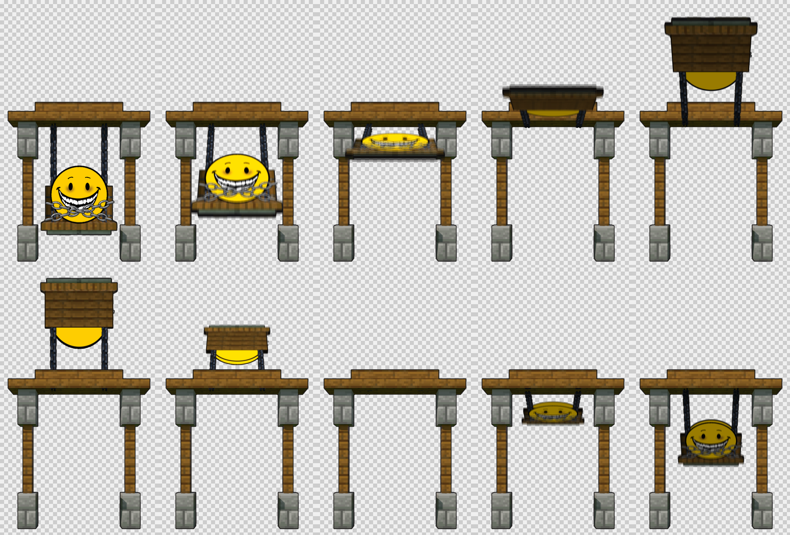

# Персонажи — развороты (спереди / сбоку / сзади)

Все персонажи нарисованы в стиле первого референса: большая голова, простое лицо
(глаза-овалы, нос «уголком»), толстый чёрный контур, плоская заливка с одной тенью.
**Руки и ноги — палки.**

## Элли


- **Одежда:** красная майка без рукавов.
- **Волосы:** каштановые с рыжиной — боковой пробор, чёлка набок, пряди у лица,
  хвост на тёмной резинке.
- **Рюкзак:** чёрно-серый. Спереди лямки с пряжками и нагрудным ремешком, сбоку — рюкзак
  в профиль с боковым карманом, сзади — молния и передний карман.
- Веснушки на щеках.

## Джоэл


- **Одежда:** рубашка цвета хаки без рукавов — воротник, планка с пуговицами, два
  нагрудных кармана с клапанами.
- **Голова:** короткие тёмные волосы, короткая борода с проседью и усы, густые брови.
- **Рюкзак:** коричневый. Спереди лямки с металлическими D-кольцами и пряжками, сбоку —
  клапан и боковой карман, сзади — клапан с двумя ремешками на пряжках.
- **Рост:** Джоэл выше Элли. Его холст 600×1100 вместо 600×1000, земля на том же отступе
  снизу, поэтому в одном масштабе рост соотносится правильно.

## Сара


- **Одежда:** розовая майка без рукавов.
- **Волосы:** светлое каре до подбородка, чёлка набок от пробора, пряди заправлены за уши.
- **Детали:** бусы с кулоном-зубом, как на фото; румянец и улыбка.
- **Рост:** немного ниже Элли — голова и тело примерно 94 % от неё, холст тот же 600×1000.

## Файлы

| Путь | Что это |
|---|---|
| `characters/<имя>/front.svg`, `side.svg`, `back.svg` | отдельные виды, вектор |
| `characters/<имя>/turnaround.svg` | лист-разворот: три вида, направляющие по высоте, палитра |
| `characters/<имя>/png/*.png` | те же файлы в PNG ×2; отдельные виды — на прозрачном фоне |
| `tools/ellie.py`, `tools/joel.py`, `tools/sarah.py` | формы и палитра каждого персонажа |
| `tools/charlib.py` | общие функции: примитивы SVG, лист-разворот |
| `tools/build_characters.py` | сборка SVG |
| `tools/render.js` | рендер SVG → PNG |

## Слои для анимации

Каждая часть лежит в отдельной группе `<g id="вид-часть">`, например `front-arm-left`,
`side-beard`, `back-backpack`. `left`/`right` — сторона самого персонажа: на виде спереди
`front-arm-left` находится справа от зрителя.

| Персонаж и вид | Группы (снизу вверх по порядку отрисовки) |
|---|---|
| Элли, спереди | `ponytail`, `hair-back`, `leg-right`, `leg-left`, `arm-right`, `arm-left`, `neck`, `top`, `backpack-straps`, `ear-right`, `ear-left`, `face`, `face-features`, `hair-lock-left`, `hair-lock-right`, `hair-tuft`, `hair` |
| Элли, сбоку | `ponytail`, `leg-left`, `leg-right`, `backpack`, `top`, `backpack-strap`, `arm-right`, `head`, `face-features`, `ear-right`, `hair-lock-right`, `hair-tuft`, `hair`, `hair-tie` |
| Элли, сзади | `leg-left`, `leg-right`, `arm-left`, `arm-right`, `top`, `backpack`, `ear-left`, `ear-right`, `head`, `hair-tuft`, `hair`, `ponytail`, `hair-tie` |
| Джоэл, спереди | `hair-back`, `leg-right`, `leg-left`, `arm-right`, `arm-left`, `neck`, `shirt`, `backpack-straps`, `ear-right`, `ear-left`, `face`, `face-features`, `beard`, `hair` |
| Джоэл, сбоку | `leg-left`, `leg-right`, `backpack`, `shirt`, `backpack-strap`, `arm-right`, `head`, `ear-right`, `face-features`, `beard`, `hair` |
| Джоэл, сзади | `leg-left`, `leg-right`, `arm-left`, `arm-right`, `shirt`, `backpack`, `ear-left`, `ear-right`, `head`, `hair` |
| Сара, спереди | `hair-back`, `leg-right`, `leg-left`, `arm-right`, `arm-left`, `neck`, `top`, `necklace`, `face`, `face-features`, `hair`, `ear-right`, `ear-left` |
| Сара, сбоку | `leg-left`, `leg-right`, `top`, `necklace`, `arm-right`, `head`, `face-features`, `hair`, `ear-right` |
| Сара, сзади | `leg-left`, `leg-right`, `arm-left`, `arm-right`, `top`, `ear-left`, `ear-right`, `hair` |

Руки и ноги — одиночные линии; первая точка пути — плечо или бедро, её удобно брать за
точку поворота.

## Палитры

| Что | Элли | Джоэл | Сара |
|---|---|---|---|
| Кожа / тень | `#f8ccb1` / `#e8ab8e` | `#f0c09c` / `#d99f7e` | `#f9d0b6` / `#eab092` |
| Волосы / тень | `#8a4b2f` / `#6a3521` | `#4b3c31` / `#34291f` | `#dab57c` / `#b68f58` |
| Борода / тень | — | `#65574b` / `#51453a` | — |
| Одежда / тень | майка `#c2423a` / `#9c332e` | рубашка хаки `#7a7955` / `#5f5e41` | майка `#e3a0b5` / `#c47f96` |
| Рюкзак / карманы, клапан | `#4b4f55` / `#3b3e43` | `#8a6039` / `#6c4a2b` | — |
| Ремни, лямки | `#2a2c30` | `#553a24` | — |
| Пряжки, металл | `#8e949b` | `#b9b4a8` | — |
| Бусы: тёмные / светлые / кулон | — | — | `#5c4433` / `#d8c5a4` / `#f4efe4` |
| Веснушки, румянец | `#d4917a` | — | `#f4a9a3` |
| Контур | `#1c1a1a` | `#1c1a1a` | `#1c1a1a` |

## Как пересобрать

```bash
python3 tools/build_characters.py        # SVG всех персонажей (или: ... sarah)

# PNG: нужен Node.js и Playwright (ставится один раз)
npm i --no-save playwright && npx playwright install chromium
node tools/render.js                     # PNG ×2 (или: node tools/render.js 2 sarah)
```

# Качели — полный оборот



Качеля со смайликом делает полный оборот («солнышко») вокруг перекладины. Камера стоит
прямо перед рамой, фон и тень от качелей удалены — вокруг прозрачность. Один оборот —
90 кадров при 30 к/с (3 с), анимация зациклена. Внизу качеля идёт быстрее, наверху
замедляется, как настоящие качели.

| Файл | Что это |
|---|---|
| `swing/swing_spin.webm` | VP9 с альфа-каналом — для сайтов и браузеров |
| `swing/swing_spin.mov` | ProRes 4444 с альфа-каналом — для After Effects, Premiere, DaVinci |
| `swing/swing_spin.webp`, `swing/swing_spin.apng` | анимированные картинки с полупрозрачными краями |
| `swing/swing_spin.gif` | GIF: прозрачность только «да/нет», поэтому края жёстче |
| `swing/frames/frame_000.png` … `frame_089.png` | кадры PNG с прозрачностью, 620×1050 |
| `swing/layers/cutout.png` | исходная картинка без фона |
| `swing/layers/frame.png` | рама: перекладина, столбы, основания |
| `swing/layers/swing_front.png`, `swing_back.png` | качеля спереди и сзади |
| `swing/source.png` | исходник |
| `tools/swing.py` | весь процесс: удаление фона, разрезка на слои, поворот в 3D, кодирование |

Как это сделано:

- **Фон.** Фон и тень — один оттенок разной яркости. Край каждого предмета считается
  смесью фона и чёрного контура, поэтому зелёной каймы нет, края сглажены.
- **Слои.** Рама остаётся пиксель в пиксель как на исходнике. Качеля — цепи, сиденье
  и смайлик — поворачивается целиком вокруг оси под перекладиной.
- **Обратная сторона.** На исходнике её нет — она дорисована: спинка сиденья из досок,
  жёлтый затылок смайлика без лица, цепи до спинки. Её видно, пока качеля наверху.
- **Объём.** Перспектива: качеля растёт, когда идёт к зрителю, и уменьшается за рамой.
  Сиденье толщиной 18 px видно, когда оно идёт ребром. Освещение слева сверху, размытие
  движения.
- **Порядок слоёв.** По глубине: перед рамой качеля проходит поверх перекладины
  и столбов, за рамой — позади них.

Параметры (камера, скорость, число кадров, толщина) — константы в начале
`tools/swing.py`. Пересборка — нужны numpy, Pillow и ffmpeg:

```bash
python3 tools/swing.py              # всё: слои, кадры, видео
python3 tools/swing.py --preview    # только лист ключевых кадров swing/preview.png
```
