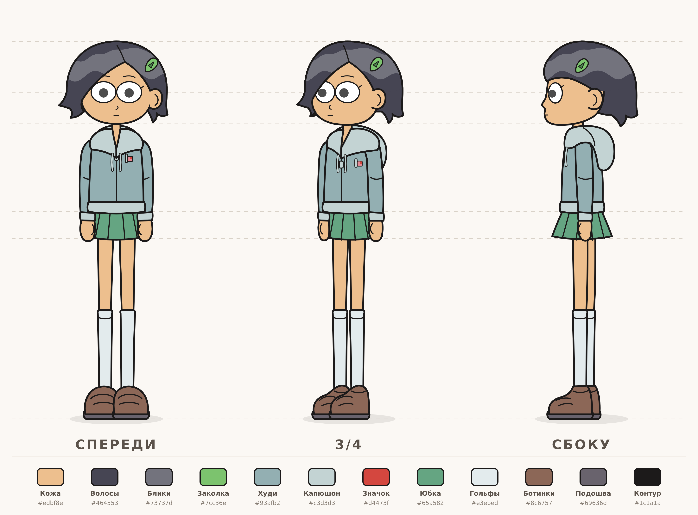

# Персонажи — развороты (спереди / 3/4 / сбоку / сзади)

Элли, Джоэл и Сара нарисованы в стиле первого референса: большая голова, простое лицо
(глаза-овалы, нос «уголком»), толстый чёрный контур, плоская заливка с одной тенью.
**Руки и ноги — палки.** Девочка в худи сохраняет стиль своего референса — см. ниже.

## Элли


- **Одежда:** красная майка без рукавов.
- **Волосы:** каштановые с рыжиной — боковой пробор, чёлка набок, пряди у лица,
  хвост на тёмной резинке.
- **Рюкзак:** чёрно-серый. Спереди лямки с пряжками и нагрудным ремешком, сбоку — рюкзак
  в профиль с боковым карманом, сзади — молния и передний карман.
- Веснушки на щеках.

## Джоэл


- **Одежда:** рубашка цвета хаки без рукавов — воротник, планка с пуговицами, два
  нагрудных кармана с клапанами.
- **Голова:** короткие тёмные волосы, короткая борода с проседью и усы, густые брови.
- **Рюкзак:** коричневый. Спереди лямки с металлическими D-кольцами и пряжками, сбоку —
  клапан и боковой карман, сзади — клапан с двумя ремешками на пряжках.
- **Рост:** Джоэл выше Элли. Его холст 600×1100 вместо 600×1000, земля на том же отступе
  снизу, поэтому в одном масштабе рост соотносится правильно.

## Сара


- **Одежда:** розовая майка без рукавов.
- **Волосы:** светлое каре до подбородка, чёлка набок от пробора, пряди заправлены за уши.
- **Детали:** бусы с кулоном-зубом, как на фото; румянец и улыбка.
- **Рост:** немного ниже Элли — голова и тело примерно 94 % от неё, холст тот же 600×1000.

## Девочка в худи



- **Виды:** спереди, 3/4 и сбоку. Поза нейтральная — руки опущены вдоль тела, ноги
  прямо, лицо без эмоций, взгляд вперёд. В 3/4 и сбоку она повёрнута лицом влево от
  зрителя, поэтому видна её левая сторона — с ухом и заколкой, как на референсе.
- **Стиль — как на референсе:** тонкий контур, плоская заливка без теней, большие
  круглые глаза, руки и ноги с толщиной (не палки), рост ≈ 4,6 головы.
- **Волосы:** тёмное каре с волнистой полосой серых бликов, пробор чуть правее центра.
  Справа (её левая сторона) волосы заправлены за ухо и торчат завитком под ним, там же
  зелёная заколка; слева закрывают ухо и топорщатся прядкой.
- **Одежда:** серо-голубое худи на молнии со светлым капюшоном-воротником, шнурками,
  манжетами и поясом, значок на груди слева; зелёная плиссированная юбка; белые гольфы
  до колена; массивные коричневые ботинки на серой подошве.
- **Холст:** 600×1100, земля y=1052 — как у Джоэла.

## Файлы

| Путь | Что это |
|---|---|
| `characters/<имя>/front.svg`, `side.svg`, `back.svg` | отдельные виды, вектор (у девочки в худи вместо `back.svg` — `three_quarter.svg`) |
| `characters/<имя>/turnaround.svg` | лист-разворот: три вида, направляющие по высоте, палитра |
| `characters/<имя>/png/*.png` | те же файлы в PNG ×2; отдельные виды — на прозрачном фоне |
| `tools/ellie.py`, `tools/joel.py`, `tools/sarah.py`, `tools/hoodie_girl.py` | формы и палитра каждого персонажа |
| `tools/charlib.py` | общие функции: примитивы SVG, лист-разворот |
| `tools/build_characters.py` | сборка SVG |
| `tools/render.js` | рендер SVG → PNG |

## Слои для анимации

Каждая часть лежит в отдельной группе `<g id="вид-часть">`, например `front-arm-left`,
`side-beard`, `back-backpack`. `left`/`right` — сторона самого персонажа: на виде спереди
`front-arm-left` находится справа от зрителя.

| Персонаж и вид | Группы (снизу вверх по порядку отрисовки) |
|---|---|
| Элли, спереди | `ponytail`, `hair-back`, `leg-right`, `leg-left`, `arm-right`, `arm-left`, `neck`, `top`, `backpack-straps`, `ear-right`, `ear-left`, `face`, `face-features`, `hair-lock-left`, `hair-lock-right`, `hair-tuft`, `hair` |
| Элли, сбоку | `ponytail`, `leg-left`, `leg-right`, `backpack`, `top`, `backpack-strap`, `arm-right`, `head`, `face-features`, `ear-right`, `hair-lock-right`, `hair-tuft`, `hair`, `hair-tie` |
| Элли, сзади | `leg-left`, `leg-right`, `arm-left`, `arm-right`, `top`, `backpack`, `ear-left`, `ear-right`, `head`, `hair-tuft`, `hair`, `ponytail`, `hair-tie` |
| Джоэл, спереди | `hair-back`, `leg-right`, `leg-left`, `arm-right`, `arm-left`, `neck`, `shirt`, `backpack-straps`, `ear-right`, `ear-left`, `face`, `face-features`, `beard`, `hair` |
| Джоэл, сбоку | `leg-left`, `leg-right`, `backpack`, `shirt`, `backpack-strap`, `arm-right`, `head`, `ear-right`, `face-features`, `beard`, `hair` |
| Джоэл, сзади | `leg-left`, `leg-right`, `arm-left`, `arm-right`, `shirt`, `backpack`, `ear-left`, `ear-right`, `head`, `hair` |
| Сара, спереди | `hair-back`, `leg-right`, `leg-left`, `arm-right`, `arm-left`, `neck`, `top`, `necklace`, `face`, `face-features`, `hair`, `ear-right`, `ear-left` |
| Сара, сбоку | `leg-left`, `leg-right`, `top`, `necklace`, `arm-right`, `head`, `face-features`, `hair`, `ear-right` |
| Сара, сзади | `leg-left`, `leg-right`, `arm-left`, `arm-right`, `top`, `ear-left`, `ear-right`, `hair` |
| Девочка в худи, спереди | `hair-back`, `leg-right`, `sock-right`, `shoe-right`, `leg-left`, `sock-left`, `shoe-left`, `skirt`, `hood-back`, `neck`, `hand-right`, `arm-right`, `hand-left`, `arm-left`, `hoodie`, `hood`, `face`, `face-features`, `hair`, `hair-part`, `hair-clip`, `ear-left` |
| Девочка в худи, 3/4 | `hair-back`, `hood-back`, `leg-right`, `sock-right`, `shoe-right`, `leg-left`, `sock-left`, `shoe-left`, `skirt`, `neck`, `hand-right`, `arm-right`, `hoodie`, `hand-left`, `arm-left`, `hood`, `face`, `face-features`, `hair`, `hair-part`, `hair-clip`, `ear-left` |
| Девочка в худи, сбоку | `hair-back`, `leg-right`, `sock-right`, `shoe-right`, `leg-left`, `sock-left`, `shoe-left`, `skirt`, `neck`, `hoodie`, `hand-left`, `arm-left`, `hood`, `face`, `face-features`, `hair`, `hair-clip`, `ear-left` |

У Элли, Джоэла и Сары руки и ноги — одиночные линии; первая точка пути — плечо или
бедро, её удобно брать за точку поворота. У девочки в худи руки и ноги — залитые формы:
рукав (`arm-*`) и кисть (`hand-*`), нога, гольф и ботинок — отдельные группы; ухо
нарисовано поверх волос, потому что волосы заправлены за него.

## Палитры

| Что | Элли | Джоэл | Сара |
|---|---|---|---|
| Кожа / тень | `#f8ccb1` / `#e8ab8e` | `#f0c09c` / `#d99f7e` | `#f9d0b6` / `#eab092` |
| Волосы / тень | `#8a4b2f` / `#6a3521` | `#4b3c31` / `#34291f` | `#dab57c` / `#b68f58` |
| Борода / тень | — | `#65574b` / `#51453a` | — |
| Одежда / тень | майка `#c2423a` / `#9c332e` | рубашка хаки `#7a7955` / `#5f5e41` | майка `#e3a0b5` / `#c47f96` |
| Рюкзак / карманы, клапан | `#4b4f55` / `#3b3e43` | `#8a6039` / `#6c4a2b` | — |
| Ремни, лямки | `#2a2c30` | `#553a24` | — |
| Пряжки, металл | `#8e949b` | `#b9b4a8` | — |
| Бусы: тёмные / светлые / кулон | — | — | `#5c4433` / `#d8c5a4` / `#f4efe4` |
| Веснушки, румянец | `#d4917a` | — | `#f4a9a3` |
| Контур | `#1c1a1a` | `#1c1a1a` | `#1c1a1a` |

Девочка в худи (без теней):

| Что | Цвет |
|---|---|
| Кожа | `#edbf8e` |
| Волосы / блики | `#464553` / `#73737d` |
| Заколка / вырез | `#7cc36e` / `#4c8a4e` |
| Глаза / зрачки | `#ffffff` / `#4c4c4c` |
| Худи / капюшон, манжеты, пояс, шнурки | `#93afb2` / `#c3d3d3` |
| Значок | `#e58a95` / `#d4473f` |
| Юбка | `#65a582` |
| Гольфы | `#e3ebed` |
| Ботинки / подошва | `#8c6757` / `#69636d` |
| Контур | `#1c1a1a` |

## Как пересобрать

```bash
python3 tools/build_characters.py        # SVG всех персонажей (или: ... hoodie_girl)

# PNG: нужен Node.js и Playwright (ставится один раз)
npm i --no-save playwright && npx playwright install chromium
node tools/render.js                     # PNG ×2 (или: node tools/render.js 2 sarah)
```
