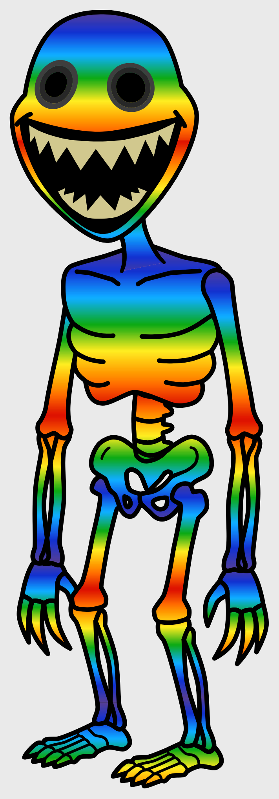
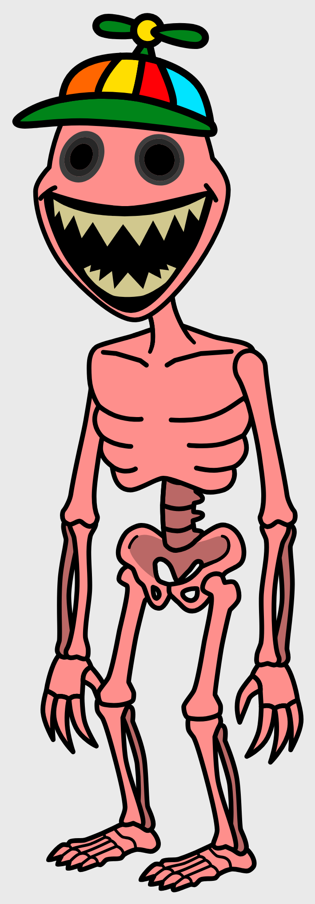
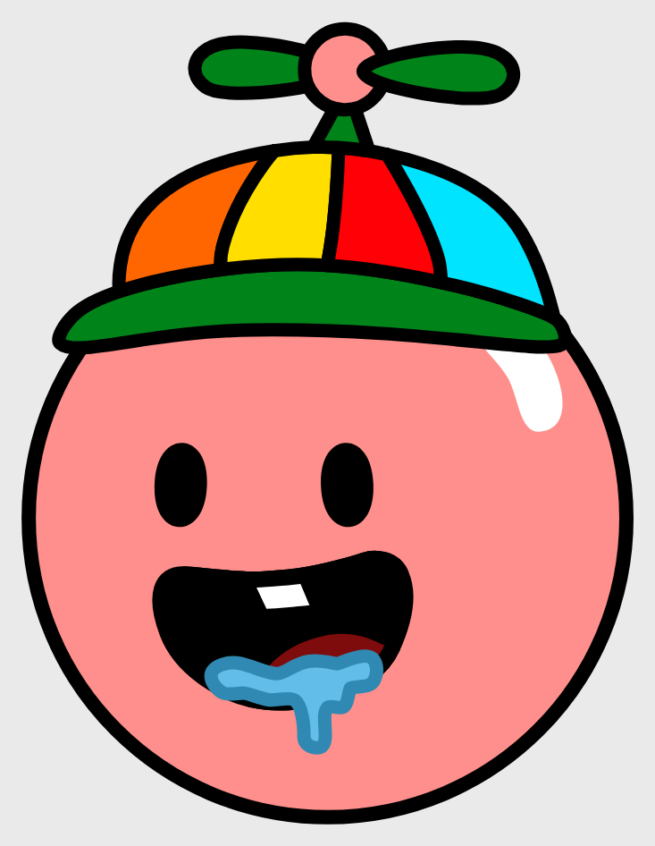
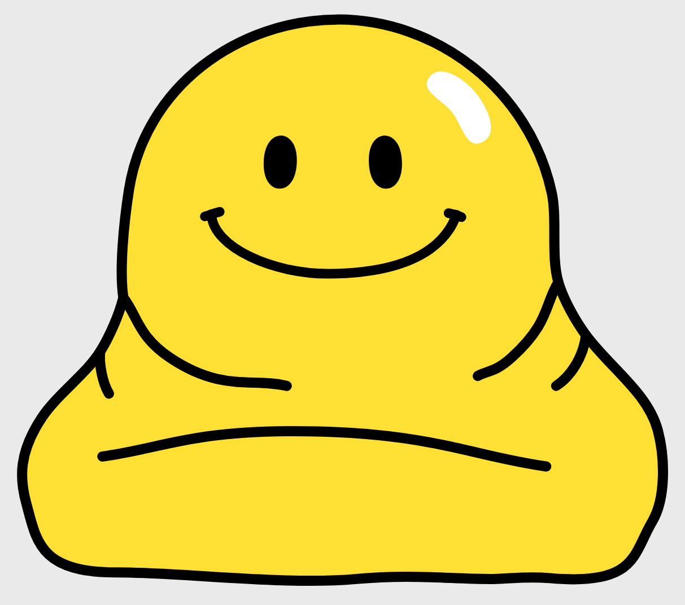
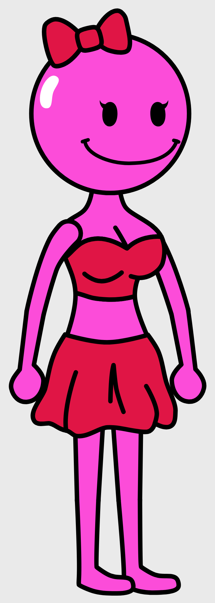
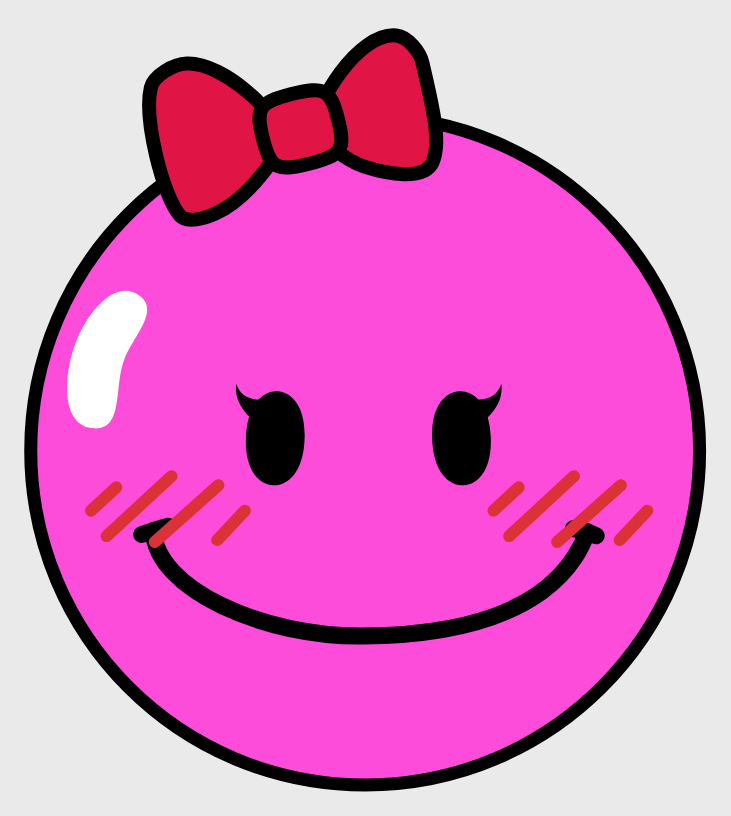
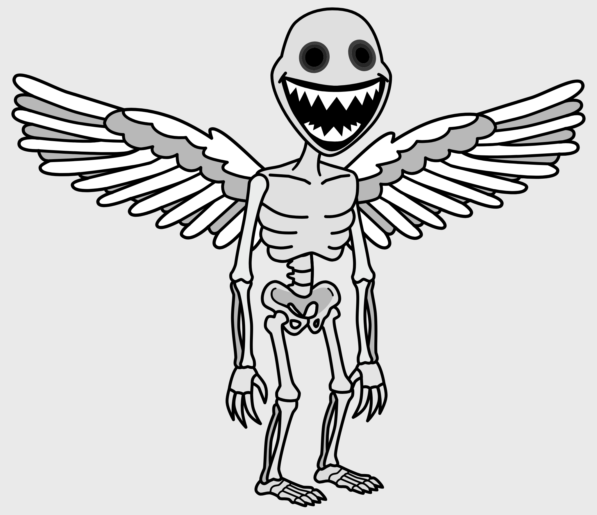
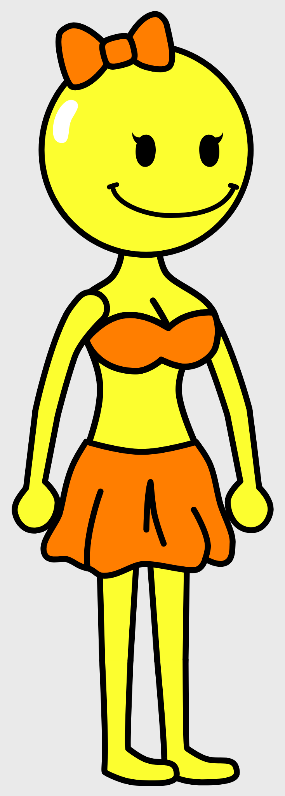
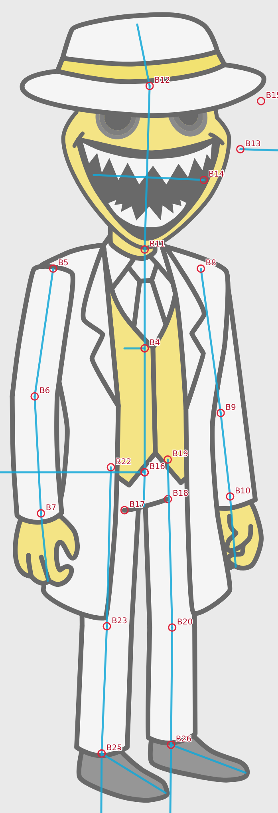
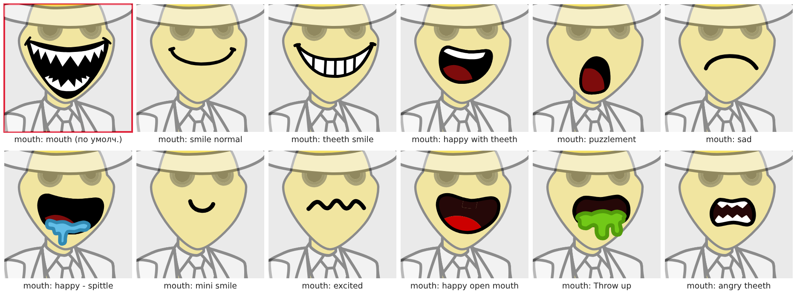

# Персонажи — развороты (спереди / сбоку / сзади)

Все персонажи нарисованы в стиле первого референса: большая голова, простое лицо
(глаза-овалы, нос «уголком»), толстый чёрный контур, плоская заливка с одной тенью.
**Руки и ноги — палки.**

## Элли


- **Одежда:** красная майка без рукавов.
- **Волосы:** каштановые с рыжиной — боковой пробор, чёлка набок, пряди у лица,
  хвост на тёмной резинке.
- **Рюкзак:** чёрно-серый. Спереди лямки с пряжками и нагрудным ремешком, сбоку — рюкзак
  в профиль с боковым карманом, сзади — молния и передний карман.
- Веснушки на щеках.

## Джоэл


- **Одежда:** рубашка цвета хаки без рукавов — воротник, планка с пуговицами, два
  нагрудных кармана с клапанами.
- **Голова:** короткие тёмные волосы, короткая борода с проседью и усы, густые брови.
- **Рюкзак:** коричневый. Спереди лямки с металлическими D-кольцами и пряжками, сбоку —
  клапан и боковой карман, сзади — клапан с двумя ремешками на пряжках.
- **Рост:** Джоэл выше Элли. Его холст 600×1100 вместо 600×1000, земля на том же отступе
  снизу, поэтому в одном масштабе рост соотносится правильно.

## Сара


- **Одежда:** розовая майка без рукавов.
- **Волосы:** светлое каре до подбородка, чёлка набок от пробора, пряди заправлены за уши.
- **Детали:** бусы с кулоном-зубом, как на фото; румянец и улыбка.
- **Рост:** немного ниже Элли — голова и тело примерно 94 % от неё, холст тот же 600×1000.

## Файлы

| Путь | Что это |
|---|---|
| `characters/<имя>/front.svg`, `side.svg`, `back.svg` | отдельные виды, вектор |
| `characters/<имя>/turnaround.svg` | лист-разворот: три вида, направляющие по высоте, палитра |
| `characters/<имя>/png/*.png` | те же файлы в PNG ×2; отдельные виды — на прозрачном фоне |
| `tools/ellie.py`, `tools/joel.py`, `tools/sarah.py` | формы и палитра каждого персонажа |
| `tools/charlib.py` | общие функции: примитивы SVG, лист-разворот |
| `tools/build_characters.py` | сборка SVG |
| `tools/render.js` | рендер SVG → PNG |

## Слои для анимации

Каждая часть лежит в отдельной группе `<g id="вид-часть">`, например `front-arm-left`,
`side-beard`, `back-backpack`. `left`/`right` — сторона самого персонажа: на виде спереди
`front-arm-left` находится справа от зрителя.

| Персонаж и вид | Группы (снизу вверх по порядку отрисовки) |
|---|---|
| Элли, спереди | `ponytail`, `hair-back`, `leg-right`, `leg-left`, `arm-right`, `arm-left`, `neck`, `top`, `backpack-straps`, `ear-right`, `ear-left`, `face`, `face-features`, `hair-lock-left`, `hair-lock-right`, `hair-tuft`, `hair` |
| Элли, сбоку | `ponytail`, `leg-left`, `leg-right`, `backpack`, `top`, `backpack-strap`, `arm-right`, `head`, `face-features`, `ear-right`, `hair-lock-right`, `hair-tuft`, `hair`, `hair-tie` |
| Элли, сзади | `leg-left`, `leg-right`, `arm-left`, `arm-right`, `top`, `backpack`, `ear-left`, `ear-right`, `head`, `hair-tuft`, `hair`, `ponytail`, `hair-tie` |
| Джоэл, спереди | `hair-back`, `leg-right`, `leg-left`, `arm-right`, `arm-left`, `neck`, `shirt`, `backpack-straps`, `ear-right`, `ear-left`, `face`, `face-features`, `beard`, `hair` |
| Джоэл, сбоку | `leg-left`, `leg-right`, `backpack`, `shirt`, `backpack-strap`, `arm-right`, `head`, `ear-right`, `face-features`, `beard`, `hair` |
| Джоэл, сзади | `leg-left`, `leg-right`, `arm-left`, `arm-right`, `shirt`, `backpack`, `ear-left`, `ear-right`, `head`, `hair` |
| Сара, спереди | `hair-back`, `leg-right`, `leg-left`, `arm-right`, `arm-left`, `neck`, `top`, `necklace`, `face`, `face-features`, `hair`, `ear-right`, `ear-left` |
| Сара, сбоку | `leg-left`, `leg-right`, `top`, `necklace`, `arm-right`, `head`, `face-features`, `hair`, `ear-right` |
| Сара, сзади | `leg-left`, `leg-right`, `arm-left`, `arm-right`, `top`, `ear-left`, `ear-right`, `hair` |

Руки и ноги — одиночные линии; первая точка пути — плечо или бедро, её удобно брать за
точку поворота.

## Палитры

| Что | Элли | Джоэл | Сара |
|---|---|---|---|
| Кожа / тень | `#f8ccb1` / `#e8ab8e` | `#f0c09c` / `#d99f7e` | `#f9d0b6` / `#eab092` |
| Волосы / тень | `#8a4b2f` / `#6a3521` | `#4b3c31` / `#34291f` | `#dab57c` / `#b68f58` |
| Борода / тень | — | `#65574b` / `#51453a` | — |
| Одежда / тень | майка `#c2423a` / `#9c332e` | рубашка хаки `#7a7955` / `#5f5e41` | майка `#e3a0b5` / `#c47f96` |
| Рюкзак / карманы, клапан | `#4b4f55` / `#3b3e43` | `#8a6039` / `#6c4a2b` | — |
| Ремни, лямки | `#2a2c30` | `#553a24` | — |
| Пряжки, металл | `#8e949b` | `#b9b4a8` | — |
| Бусы: тёмные / светлые / кулон | — | — | `#5c4433` / `#d8c5a4` / `#f4efe4` |
| Веснушки, румянец | `#d4917a` | — | `#f4a9a3` |
| Контур | `#1c1a1a` | `#1c1a1a` | `#1c1a1a` |

## Как пересобрать

```bash
python3 tools/build_characters.py        # SVG всех персонажей (или: ... sarah)

# PNG: нужен Node.js и Playwright (ставится один раз)
npm i --no-save playwright && npx playwright install chromium
node tools/render.js                     # PNG ×2 (или: node tools/render.js 2 sarah)
```

---

# Персонажи из Moho — каждый слой в PNG

Исходники лежат в `moho/*.moho`: риги с костями из Moho. Картинка-радуга для
радужного скелета лежит в `moho/Images/`. Каждый векторный слой выгружен
в отдельный PNG **на общем холсте персонажа**. У всех PNG одного персонажа одинаковый
размер, а часть нарисована ровно на своём месте. Положите файлы друг на друга по порядку
номеров, и руки, локти, колени встанут туда же, где они в Moho.

Всё снято в позе покоя (кадр 0 Moho). Кости в ней ничего не деформируют, поэтому каждая
часть выглядит так, как нарисована. Масштаб тот же, что в проекте: 1 единица Moho =
1000 px (кадр 2000×2000).

| Персонаж | Папка | Холст | Слоёв | Рты | Глаза | Костей |
|---|---|---|---|---|---|---|
|  All verity color | `rigs/all-verity-color/` | 711×2036 | 17 | 12 | — | 23 |
|  child verity big | `rigs/child-verity-big/` | 709×2031 | 18 | 12 | — | 24 |
|  child verity pink | `rigs/child-verity-pink/` | 733×946 | 2 | 6 | 3 | 6 |
|  fat verity small | `rigs/fat-verity-small/` | 1213×1072 | 1 | 4 | 3 | 4 |
|  girl verity big | `rigs/girl-verity-big/` | 734×2045 | 12 | 11 | 3 | 27 |
|  girl verity small | `rigs/girl-verity-small/` | 731×816 | 3 | 11 | 3 | 5 |
|  lord verity big | `rigs/lord-verity-big/` | 697×2035 | 17 | 12 | — | 27 |
|  lord verity small | `rigs/lord-verity-small/` | 801×824 | 2 | 11 | 3 | 7 |
|  skeleton verity big | `rigs/skeleton-verity-big/` | 2054×1773 | 19 | 12 | — | 25 |
|  skeleton verity small | `rigs/skeleton-verity-small/` | 1266×812 | 1 | 11 | 3 | 6 |
|  skeleton verity small v1 | `rigs/skeleton-verity-small-v1/` | 1266×812 | 1 | 11 | 3 | 6 |
|  verity big girl | `rigs/verity-big-girl/` | 734×2045 | 12 | 11 | 3 | 27 |

**skeleton verity small** — исправленный автором вариант (тело круглее, крылья отодвинуты): смотрит
влево, крыло со стороны взгляда — за телом, внизу. Прежний вариант сохранён как
`moho/skeleton verity small v1.moho` → `rigs/skeleton-verity-small-v1/`; ролики 1–26 используют его.

«Слоёв» — обычные слои без вариантов рта и глаз. У All verity color, child, lord и
skeleton verity big глаза — один слой `eye`, без вариантов.

**All verity color** — радужный скелет. В Moho каждая группа (рука, нога, тело, голова)
закрашена картинкой-радугой через маску. В PNG каждая часть уже радужная, с обводкой:
заливка части, поверх неё радуга, обрезанная по форме этой части, а сверху линии
(в Moho у этих слоёв включено «исключить линии из маски»). Верхушка позвоночника в слое
`hip` выходит за край картинки и осталась исходного цвета, как и в Moho: в собранном
персонаже её закрывает тело.

## Что лежит в папке персонажа

| Файл | Что это |
|---|---|
| `png/NN-слой.png` | слой на прозрачном фоне, холст общий для всего персонажа. `NN` — порядок отрисовки снизу вверх |
| `png/NN-mouth--вариант.png`, `png/NN-eyes--вариант.png` | варианты switch-слоя: у них общий номер `NN`, показывать нужно один |
| `svg/…` | те же слои в векторе |
| `preview.png` | персонаж целиком из тех же слоёв, с вариантами по умолчанию, как в Moho на кадре 0 |
| `bones.png` | то же с костями: синяя линия — кость, красный кружок — её сустав (точка поворота) |
| `variants.png` | все рты и глаза, каждый на лице на своём месте; красная рамка — вариант по умолчанию |
| `rig.json` | кости, привязка слоёв, порядок, рамки — всё в пикселях холста |

Названия слоёв взяты из Moho: `hand left 1/2/3` — плечо, предплечье, кисть;
`leg left 1/2/3` — бедро, голень, стопа. `left`/`right` — как назвали в Moho.

 

## rig.json — для анимации

- `bones[]`: `base` — сустав (начало кости), `tip` — конец, `angle_deg` — угол на экране
  (0° = вправо, по часовой), `parent` — родительская кость, `drives` — какие слои она
  ведёт.
- `layers[]` и `switches[].children[]`: `png`, `order`, `bbox` (где на холсте нарисована
  часть) и привязка:
  - `bone` + `pivot` — кость слоя и её сустав. Поворачивать PNG нужно вокруг `pivot`,
    а дочерние кости и слои двигать вместе с родительской костью;
  - `binding: "rigid"` — слой целиком следует за одной костью, как в Moho;
  - `binding: "points"` — точки слоя в Moho привязаны к двум костям (`point_bones`).
    Например, у девочек `hand left 2` — предплечье с кистью, у лорда `leg left 3` —
    ботинок. Одним PNG такой слой может только повернуться за главной костью `bone`,
    сгиб внутри него не получится;
  - `binding: "flexible"` — слой гнётся по нескольким костям (`flexible_bones`, туловище
    девочек и лорда). В PNG он следует за корневой из них;
  - `binding: "none"` — слой не привязан ни к одной существующей кости.
- `switches[]`: `default` — вариант на кадре 0. `smart_bone` и `smart_bone_frames`
  показывают, какая умная кость (`mouth`, `eye`) переключает варианты в Moho и на каком
  кадре её действия стоит каждый вариант.
- `moho_frame.offset` переводит пиксели холста в пиксели кадра Moho 2000×2000:
  `кадр = холст + offset`.

**Замечание по ригу.** В `girl verity small` switch-слой `mouth` привязан к кости с номером 8
(счёт с нуля), а в файле всего 5 костей: похоже, слой скопирован из большой версии. Поэтому в
`rig.json` у её ртов стоит `binding: "none"`. Если в Moho рот не едет вместе с
головой, причина в этом: его нужно заново привязать к кости.

## Как пересобрать

```bash
python3 tools/moho_export.py                       # SVG + rig.json для всех файлов из moho/
python3 tools/moho_export.py "moho/fat verity small.moho"   # или только один
node tools/render_rigs.js                          # PNG (нужен Playwright, см. выше)
```

`tools/moho_export.py` читает `.moho` (zip с JSON Moho) без сторонних библиотек.
Кривые строятся так же, как в Moho: из кривизны, веса и поворота ручек каждой точки.
Формулы сверены с [описанием формата](https://github.com/vinhio/moho2svg), восстановленным
по экспорту самого Moho. Результат проверен наложением на превью, которое Moho сохраняет
внутри `.moho`.

---

# Анимация: Скелет против Лорда (25 секунд, v2)

`animations/skeleton-vs-lord/skeleton-vs-lord.mp4`: 1920×1080, 24 кадра/с, 600 кадров,
H.264, без звука. Сделано по гайду автора (`docs/animal_hospital_long.md`) и образцу
`05_fat_lord_girl.mp4`:
- никаких надписей, цифр, полосок здоровья и аватарок;
- размеры как в образце: шарик ~300 px, большие ~730 px от макушки до подошв, земля на y≈816;
- оба начинают маленькими и смотрят друг на друга; первые 4 секунды стоят неподвижно;
- большая версия появляется только после злости: жилка и пар → широкая ухмылка → золотые
  лучи, дрожь и рост → вспышка, серое облако дыма, тряска → большой стоит на месте шарика;
- ноги в три четверти: оба колена гнутся вперёд к носкам, стопы стоят ровно и не скользят;
- рука, которая должна быть перед телом, на этот момент поднимается над телом (или над
  соперником, когда бьёт), потом возвращается назад.

| Время | Что происходит |
|---|---|
| 0–4 с | Маленькие Лорд (слева) и Скелет (справа) стоят и смотрят друг на друга |
| 4–6.5 с | Лорд подпрыгивает ближе, приседает, дрожит и бьёт головой в живот |
| 6.5–8.6 с | Скелет кувырком отлетает, над ним звёздочки; Лорд смеётся |
| 8.6–11.7 с | Скелет злится и превращается в большого; Лорд пугается и потеет |
| 11.3–13.6 с | Большой Скелет подходит и с замаха шлёпает Лорда, тот кувырком улетает |
| 14.7–17.5 с | Лорд злится и превращается в большого; Скелет пугается |
| 17.5–19.5 с | Скелет бьёт, Лорд отскакивает назад — промах |
| 19.7–21.1 с | Лорд дальней рукой снимает шляпу и бросает: шляпа бьёт Скелета в лицо и возвращается на голову |
| 21.4–22.8 с | Лорд подходит и бьёт апперкотом, Скелет улетает за кадр, на месте — блеск |
| 22.8–25 с | Лорд идёт в центр, поворачивается к зрителю и поднимает руки буквой V. Победил Лорд |

## Как это сделано (движок v2)

- Направление тела берётся из рига: куда смотрят носки (у Лорда вправо, у Скелета влево).
  Колени всегда гнутся в сторону носков, локти — назад. Если персонаж повёрнут к сопернику
  другой стороной, рисунок зеркалится целиком, а не одна нога.
- Позы ставятся «поза на позу»: ключ держится, пока не начнётся переход к следующему
  (`Track.add(кадр, поза, ease, длительность)`), поэтому нет дрейфа и «дыхания».
- Стопы задаются точкой на земле. Шаг: опорная стопа стоит, вторая поднимается и
  переставляется, ноги почти прямые, подошвы ровно.
- Удар задаётся целью (`hitF: 1, hitFto: 'lord:cheek'`): кисть доходит до края лица
  соперника на длину руки. После кадра удара цель замирает (`hitFfix`), и рука не
  тянется за улетевшим соперником. `over: 'F'` рисует бьющую руку поверх соперника.
- `zF`/`zB: 'front'|'back'` поднимает руку над телом или убирает её за тело на время.
- `look` сдвигает глаза и рот к сопернику и чуть сужает голову (вид в три четверти).
- Дым, лучи, вспышка, пот, пар, жилка, звёздочки, пыль и блеск — в `animations/fx.js`.

| Файл | Что это |
|---|---|
| `animations/engine.js` | загрузка ригов, кости, IK, ключи «поза на позу», рисование |
| `animations/fx.js` | фон под Minecraft (небо, облака, трава, земля), эффекты |
| `animations/stage.js` | общая сцена драки: ключи, помощники движения, эффекты, сборка кадра |
| `animations/skeleton-vs-lord/scene.js` | сценарий по кадрам: позы, превращения, удары |
| `tools/render_anim.js` | рендер в MP4 (Chromium + ffmpeg) или отдельные кадры |

```bash
node tools/render_anim.js animations/skeleton-vs-lord                          # видео
node tools/render_anim.js animations/skeleton-vs-lord --still 6.5,12.5 --out /tmp/kadry   # кадры (секунды)
```

---

# Ролики 2–24

Все по одному шаблону: 25 с, 24 кадра/с, 1920×1080, только звуковые эффекты, первые 4 с
стойка, хотя бы один боец большой к 5-й секунде, победитель в центре. По просьбе автора
чаще большие девушки, и когда девушка становится большой — в неё влюбляются.

Общие приёмы — в `animations/stage.js`: `strike` (удар рукой с замахом), `kick`, `dodge`
(отскок назад), `duck` (нырок, не глубже 60 % ноги), `recoil`, `fallBack` (на спину), `flyOff`
(улёт с блеском), `victory`, `turn`, `love` (сердечки вместо глаз — центры глаз из
`animations/eyes.json`, его пишет `tools/eyes.py`), `blowKiss`. `transform(..., { love: 'кто' })`
— кто влюбляется, когда превратился. Жёлтая и радужная маленькие версии — перекраска рига при
загрузке (`recolor: 'yellow' | 'rainbow'`).

| № | Папка | Кто | Победил |
|---|---|---|---|
| 2 | `animations/v02-skel-love` | Скелет и Розовая девочка: она большая — он влюбился и получил пинок; он большой — влюбилась она, его ответный «поцелуй» её роняет | Скелет |
| 3 | `animations/v03-yellow-lord` | Жёлтая девочка и Лорд: она большая — шарик-Лорд влюбился, щелчок по лбу; Лорд большой — промах, пощёчина, бросает шляпу — она ловит и надевает, пинок за кадр | Жёлтая |
| 4 | `animations/v04-pink-fat` | Розовая и Толстый: она большая — он влюбился, прыгнул обнять и плюхнулся блином; пинок в живот-батут отбросил её; он катится колесом — воздушный поцелуй, снова влюблён; пинок снизу в небо | Розовая |
| 5 | `animations/v05-rainbow-yellow` | Радужный и Жёлтая: он большой — хватает шарик-Жёлтую за бантик и бросает; она большая — он влюбился, пощёчина, кружится; бьёт — она ныряет, пинок по голени, скачет на одной ноге и падает | Жёлтая |
| 6 | `animations/v06-pink-yellow` | Розовая и Жёлтая: Розовая большая топает — мимо, шарик-Жёлтая подсекает её; прискакал Лорд, Жёлтая большая — Лорд влюбился; пощёчины по очереди и разом, кружатся; нырок и апперкот за кадр | Жёлтая |
| 7 | `animations/v07-lord-banana` | Банановая кожура: Лорд большой идёт на шарик-Розовую — она толкает кожуру ему под ногу, он падает; Розовая большая — Лорд влюбился, снова на кожуру, едет на спине к её ногам — пинок за кадр | Розовая |
| 8 | `animations/v08-baby-gift` | Подарок: Малыш большой садится на шарик-Жёлтую — лепёшка; Жёлтая большая — Малыш влюбился; она бросает ему подарок — перчатка на пружине в лицо; он спотыкается о коробку, пинок за кадр | Жёлтая |
| 9 | `animations/v09-fat-glutton` | Обжора: Скелет большой бьёт в живот — батут роняет его; Толстый огромным ртом засасывает и глотает Скелета, жуёт; Розовая большая — Толстый влюбился, её пинок — выплюнул Скелета вверх, тот упал на Толстого — лепёшка, Скелет в слюнях тоже влюбился | Розовая |
| 10 | `animations/v10-two-admirers` | Два поклонника: шарик-Жёлтая падает с неба между Лордом и Скелетом и становится большой — оба влюбились; два щелчка разом; оба большие, ссорятся через её голову (шляпа в лицо, ветер от крыльев); она бьёт обоих и пинками отправляет за кадр | Жёлтая |
| 11 | `animations/v11-apple-tree` | Яблоня: Радужный большой пинает ствол — три яблока по макушке шарика-Розовой; она большая — он влюбился, обнял воздух; злой пинает ствол — град яблок на него, падает лицом в траву; золотое яблоко отскакивает ей в руку, пинок по пяткам — уезжает за кадр | Розовая |
| 12 | `animations/v12-bubble-gum` | Жвачка: Малыш большой надувает пузырь — шарик-Розовая прыгает ему на ногу, пузырь лопается на лицо; вслепую спотыкается о шарик и падает на него; Розовая большая — он влюбился, надувает ей пузырь — она лопает пальцем; её огромный пузырь прилипает к нему и уносит в небо | Розовая |
| 13 | `animations/v13-rain-cloud` | Тучка: Скелет большой приводит на верёвочке тучку — дождь на шарик-Жёлтую; она большая — он влюбился и выпустил верёвочку; она ловит и дёргает — молния в Скелета, падает; тучка поливает его до конца ролика | Жёлтая |
| 14 | `animations/v14-kiss` | Поцелуй: Лорд большой пинает радужный шарик, Радужный большой; с неба падает Розовая и становится большой — оба влюбились, тянутся целовать — она снова шарик, и они целуют друг друга, «фу!»; она опять большая — двойная пощёчина, оба улетают за кадр | Розовая |
| 15 | `animations/v15-seesaw` | Качели: Малыш большой прыгает на край — Толстого в небо; Толстый падает обратно — Малыш в небо и втыкается головой в землю; шарик-Жёлтая становится большой — оба влюблены; пинок — Толстый перелетает качели и садится на Малыша, тот в блин | Жёлтая |
| 16 | `animations/v16-tug-of-war` | Канат: Радужный большой бросает канат — шарик-Розовая хватает зубами, рывок — шлёп в грязь; Розовая большая — он влюбился; она дёргает — он падает в грязь; честное перетягивание — она отпускает, его уносит за кадр | Розовая |
| 17 | `animations/v17-cake` | Торт: Скелет большой держит торт над головой — Толстый прыгает мимо; торт брошен далеко — Толстый глотает его целиком; с неба Жёлтая — оба влюблены; Толстый прыгает к ней — она приседает, он падает на Скелета | Жёлтая |
| 18 | `animations/v18-crown` | Корона: с неба корона, Жёлтая большая надевает её — шарик-Розовая бьёт головой по голени, корона падает ей на голову; Розовая большая, Лорд влюблён; пощёчины, Жёлтая кружится и улетает от пинка; Лорд срывает корону — пинок, корона возвращается | Розовая |
| 19 | `animations/v19-dive` | Пикирование: Скелет большой взлетает и пикирует на шарик-Жёлтую — она отпрыгивает, он лицом в траву; Жёлтая большая — влюблён, подлетает поцеловать — пощёчина, кувырком на спину; бомбой сверху — она отскакивает, он втыкается головой в землю — пинок под зад за кадр | Жёлтая |
| 20 | `animations/v20-lollipop` | Леденец: Радужный большой выдёргивает леденец изо рта шарика-Малыша и облизывает — Малыш ревёт ручьём и становится большим; летит на пропеллере — Радужный бьёт его леденцом, как битой; Розовая большая — оба влюблены, Радужный дарит ей леденец; Малыш из ревности пинает его в небо, тянется к леденцу — Розовая отправляет его за кадр | Розовая |
| 21 | `animations/v21-ball` | Мяч: Лорд большой пинает мяч в Толстого — мяч отскакивает от пуза ему в лицо; Толстый прыгает и садится ему на голову — Лорд в лепёшку; Розовая большая — оба влюблены; Лорд чеканит мяч, мяч падает Толстому на макушку и отскакивает ей в руки; она пинает мяч — Лорду в лицо, рикошетом в Толстого, пинок — Толстый за кадр | Розовая |
| 22 | `animations/v22-pillows` | Подушки: Скелет большой лупит подушкой шарик-Жёлтую — перья, она кувырком; Жёлтая большая — Скелет влюблён; она берёт вторую подушку: бац — кружится, бац — отлетает; его замах — она ныряет, он крутится сам; с прыжка подушкой по голове — подушка лопается, туча перьев; пинок — за кадр | Жёлтая |
| 23 | `animations/v23-bees` | Пчёлы: Радужный большой срывает улей и облизывает мёд — рой гонится за ним, жалит в зад; он бросает улей — тот садится Толстому на голову, пчёлы жалят Толстого, он раздувается и пузом сбивает Радужного; Розовая большая — оба влюблены, пчёлы встают сердечком; она натравливает пчёл и пинает Толстого — тот катится в Радужного, оба за кадр | Розовая |
| 24 | `animations/v24-pies` | Торты: Жёлтая большая (Малыш влюблён) кидает торт шарику-Розовой в лицо; Розовая большая (Лорд влюблён) ловит второй торт, пробует крем и бросает обратно — Жёлтая приседает, торт летит Малышу в лицо, он ревёт; Жёлтая с пощёчиной — мимо, крутится, пинок — за кадр; Лорд прыгает к победительнице | Розовая |
| 25 | `animations/v25-pink-lord` | По образцу: стойка ~2 с — и драка; шарик-Розовая дважды прыгает Лорду на голову; превращение «рост» (руки-лапы) под музыку из образца — Лорд влюблён; пинок; Лорд «щелчком» большой, держит шляпу, дышит и поёт, воздушный поцелуй; пощёчина, промах, её отскок, пинок, удар — за кадр. Фон «майнкрафт» (тема «вишня») | Розовая |
| 26 | `animations/v26-water-balloons` | Водяные шарики (драка без ударов): шарик-Скелет прыгает на шарик — брызги на Жёлтую; она «растёт» под музыку — Скелет влюблён; её шарик мимо, второй — в него, отряхивается; Скелет «растёт»; его шарик — она приседает, лопается её корзина; её шарик в лицо — он поскальзывается на луже и убегает. Фон — тема «джунгли» | Жёлтая |
| 27 | `animations/v27-boomerang` | Бумеранг (без ударов; новый маленький Скелет): шарик-Розовая выдувает пузырь — Скелета поднимает и роняет; Скелет «растёт» под присланную музыку (1.5×); бумеранг — она подпрыгивает, бумеранг возвращается ему по голове; Розовая «растёт» — влюблён, дарит цветок, она чихает — его сдувает; бумеранг снова по голове; огромный пузырь уносит его в небо. Фон — тема «закат» | Розовая |

### Серия по образцу: ролики 01–30

Как в присланном образце: ~2 с стойки и сразу действие; превращения «рост» (руки-лапы) под присланную
музыку (громко, 3 с; в 03–07 — ускоренная в 1.5 раза `sounds/ref/transform-music2.wav`, с 08 — в обычном темпе `sounds/ref/transform-music3.wav`; с 09 — ~4.3 с, две музыкальные фразы, последняя секунда плавно затихает). С 09 сжатие и растяжение сохраняют «вес» (площадь), драки плотнее — как у HugyTi; драка мягкая; фон «майнкрафт»
с голубым небом, каждый раз другой (`FX.mcBackground`, темы `MC_THEMES`). 01 = ролик 25, 02 = 26, 03 = 27.

| № | Папка | Что происходит | Победитель |
|---|---|---|---|
| 04 | `animations/mc04-snowballs` | Снежки: шарик-Малыш на пропеллере роняет снежок шарику-Жёлтой на макушку; она «растёт» — Малыш влюблён; её снежок мимо; Малыш плюёт снежком ей в лицо; её снежок попадает — он в снегу, стучит зубами; Малыш «растёт», катает огромный ком — её снежок разбивает ком у него над головой; «апчхи!» уносит его на пропеллере. Фон — тайга с горами | Жёлтая |
| 05 | `animations/mc05-slime` | Батут из слизи: радужный шарик прыгает на блок слизи и приземляется шарику-Лорду на голову; Лорд «растёт», роняет слизь Радужному на голову — тот прилип; Радужный выскакивает и «растёт», перебрасывает слизь Лорду за спину и пугает «бу!» — Лорд отпрыгивает на слизь, улетает вверх, падает вниз головой и втыкается в землю; выскакивает — снова на слизь и за кадр. Фон — равнина с подсолнухами | Радужный |
| 06 | `animations/mc06-tomatoes` | Помидоры: Толстый срывает ртом помидор с куста и плюёт шарику-Розовой в лицо; она «растёт» — Толстый влюблён; её помидоры он ловит ртом и съедает; огромный помидор с грядки — ему в лицо; вслепую скачет в куст; влюблён снова — она кладёт ему в рот помидор, его раздувает, и от громкой отрыжки он укатывается за кадр. Фон — деревня с домиками | Розовая |
| 07 | `animations/mc07-tnt` | Динамит (мультяшные взрывы — только сажа): шарик-Скелет чиркает крылом по фитилю — бум, шарик-Лорд в саже, кашляет; Лорд «растёт», бросает динамит — Скелет отбивает головой обратно, бум у ног Лорда, шляпа взлетает; Скелет «растёт» и сдувает крыльями следующий блок обратно — Лорд лицом в траву; последний фитиль гаснет, Лорд заглядывает — бум в лицо, улетает за кадр. Фон — замок и горы | Скелет |
| 08 | `animations/mc08-balloons` | Воздушные шарики: шарик-Малыш на пропеллере лопает лопастями шарик — шарик-Розовая подпрыгивает от испуга; она «растёт» — Малыш влюблён; дарит ему шарик — шарик поднимает Малыша, щелчок — лопнул, он шлёпается; Малыш «растёт», надувает огромный шарик — тот с визгом носится, она приседает, шарик шлёпает Малыша по лицу; она привязывает к нему шарики — его уносит в небо. Фон — поле цветов. Музыка превращения — в обычном темпе | Розовая |
| 09 | `animations/mc09-paint` | Краска: радужный шарик прыгает на край ведра — ведро с краской надевается шарику-Жёлтой на голову; она «растёт» — он влюблён; огромной кистью она рисует ему усы; Радужный «растёт», выхватывает кисть и красит её в радугу; она отбирает кисть, рисует яму — он проваливается, рисует дыру в небе — он падает оттуда в яму снова и снова; стирает яму — шлёп на траву; он сжимается в шарик, она перекрашивает его в серый — плачет и укатывается. Фон — берёзовая роща | Жёлтая |
| 10 | `animations/mc10-water` | Водомёт: шарик-Толстый всасывает воду из озера и плюёт струёй в шарик-Скелета — тот мокрый; Скелет «растёт», взмахом крыльев катит Толстого кувырком; вторую струю крылья разворачивают Толстому на голову — мокрый, «апчхи!»; Толстый всасывает Скелета — тот сжимается в шарик, влетает в рот, Толстый жуёт и выплёвывает; Скелет «растёт» снова, затыкает ему рот камнем — Толстого раздувает, камень вылетает пробкой, и он, как сдутый шарик, со свистом улетает за кадр. Фон — озеро | Скелет |
| 11 | `animations/mc11-pumpkins` | Тыквы: шарик-Лорд запускает шляпу бумерангом — она бьёт по кроне яблони, три яблока шарику-Жёлтой по макушке; она «растёт» — Лорд влюблён; она колдует — с неба падает тыква-фонарь и накрывает Лорда, тыква прыгает вслепую; Лорд «растёт» прямо в тыкве — она разлетается; большой Лорд тяжело дышит и поёт ей — она кидает яблоко ему в открытый рот; Лорд достаёт из шляпы огромную тыкву — та катится и расплющивает Жёлтую, яблоко ей на макушку — пуф, она снова маленькая; Жёлтая «растёт» снова, щёлкает пальцами — из земли выскакивает тыква и запускает Лорда в небо. Фон — сад, блочная яблоня | Жёлтая |
| 12 | `animations/mc12-chest` | Сундук-кусака: радужный шарик прыгает на сундук — крышка отбрасывает его, из сундука встаёт золотое яблоко; шарик-Малыш подлетает на пропеллере, хватает яблоко ртом и «растёт»; Радужный прячется в сундук — из темноты глаза, сундук кусает Малыша за руку и хохочет; Радужный выскакивает и «растёт», щёлкает сундуком, наступая, — укус за попу, Малыш подпрыгивает; Малыш дует изо всех сил — сундук вырывается, падает Радужному на голову и жуёт его, «бульк!» — Радужный снова шарик; сундук гонится за ним, оба за кадр. Фон — лес | Малыш |
| 13 | `animations/mc13-icecream` | Мороженое (шарик-Лорд — зритель, влюбляется в каждую, кто становится большой): шарик-Жёлтая лижет огромный рожок, шарик-Розовая толкает его — шоколадный шарик ей на голову, она дрожит; Жёлтая «растёт», вытаскивает рожок, лижет и морозным дыханием замораживает Розовую в ледяную глыбу — «фу!», глыба уезжает; Розовая «растёт» прямо в глыбе, отнимает рожок и бросает — он надевается Жёлтой на голову, мороженое течёт по лицу; рожок как рог единорога — радужный луч, Розовая снова шарик; Розовая «растёт» снова, щелчком притягивает рожок с мороженым, лижет и замораживает Жёлтую — «фу!», глыба уезжает за кадр. Фон — вишнёвый сад | Розовая |
| 14 | `animations/mc14-minecart` | Вагонетка: рельсы с горками по краям; шарик-Скелет дует — вагонетка с шариком-Малышом мчится, взлетает с горки и вверх дном надевается Малышу на голову; Малыш «растёт» и толкает вагонетку — она подхватывает Скелета и улетает с другой горки в небо, Скелет шлёпается обратно; Скелет «растёт», машет крыльями — вагонетка снова взлетает и надевается Малышу на голову; Малыш шатается вслепую, срывает её и бросает Скелету на голову; «пуф» — Скелет шариком падает в вагонетку, «растёт» снова, стоя в ней; Малыш дует изо всех сил — Скелет в вагонетке улетает с горки за кадр. Фон — саванна | Малыш |
| 15 | `animations/mc15-cactus` | Кактус: шарик-Толстый катится шаром для боулинга — шарик-Лорд отлетает на кактус, укол, подпрыгивает; Лорд «растёт» и тяжело дышит, вырывает блок кактуса и бросает — Толстый всасывает и глотает его, колючки торчат изнутри, он скачет от боли; надувается и стреляет колючками Лорду в лицо, прыгает на него — Лорд снова шарик под Толстым; Лорд «растёт» снова — Толстый всасывает его шляпу и выплёвывает обратно с кактусом внутри; Лорд колдует шляпой — под Толстым вырастает кактус: укол, прыжок, снова укол — и в небо. Фон — луг | Лорд |
| 16 | `animations/mc16-kite` | Воздушный змей (с этого ролика музыка превращения — только при первом превращении): радужный шарик дует — змей шарика-Розовой пикирует ей на голову; она «растёт» — Радужный влюблён; змей ныряет, хвост цепляет Радужного и уносит вверх, рывок — он летит кувырком на голову; Радужный «растёт», щелчок — над змеем туча, молния бьёт в змея, искра бежит по нитке — Розовую трясёт, она в саже и сжимается в шарик; Розовая «растёт» снова — Радужный опять влюблён; она бросает змея ему на лицо, щелчок — туча над ним, молния в змея; она дует — Радужный улетает за кадр. Фон — равнина | Розовая |
| 17 | `animations/mc17-popcorn` | Попкорн: шарик-Толстый всасывает весь попкорн из ведёрка и отрыгивает его шарику-Жёлтой в лицо; она «растёт» — Толстый влюблён, разинул рот; она бросает ему в рот початок и наводит солнечный луч — кукуруза лопается внутри, его подбрасывает с каждым «поп»; Толстый надувается и стреляет попкорном — Жёлтую заваливает горой, «пуф» — из горы вылетает шарик-Жёлтая; она «растёт» снова, под Толстым вырастает огромный початок, луч — БУМ! Толстый взлетает и падает в гору попкорна, съедает её и укатывается. Фон — грибной лес | Жёлтая |
| 18 | `animations/mc18-pickaxe` | Кирка и блоки: шарик-Лорд бьёт головой столбик — верхний блок летит шарику-Розовой на макушку; она «растёт» — блок разлетается, Лорд влюблён; она бросает кирку — та выкапывает яму под Лордом, он падает, сверху три блока-крышки, Лорд стучит изнутри; большой Лорд пробивает крышку, тяжело дышит, поёт и шлёт поцелуй — Розовая мгновенно строит стену, сердце лопается; Лорд дует — стена падает, верхний блок ей по голове — «пуф», она шарик; Розовая «растёт» снова, кирка подкапывает землю под Лордом — он по шею в яме, блоки засыпают её, последний — ему на макушку, он плачет. Фон — тайга | Розовая |
| 19 | `animations/mc19-pepper` | Острый перец: шарик-Малыш на пропеллере срывает ртом перец и роняет его зевающему шарику-Лорду в рот — Лорд краснеет, пар из ушей, огонь вверх; Лорд «растёт», съедает перец и дышит огнём на Малыша — шляпа горит, сажа, пропеллер сдувает огонь; Малыш «растёт» и бросает перец поющему Лорду в рот — огонь, шляпа горит, его раздувает — «пуф», Лорд шарик; Лорд «растёт» снова, ещё перец — Малыш закрывается огромным листом, огонь отражается в Лорда; огромный перец ему в рот — Лорд улетает ракетой. Фон — джунгли | Малыш |
| 20 | `animations/mc20-fishing` | Удочка: шарик-Скелет толкает радужного шарика-рыбака в пруд — плюх, тот выныривает с рыбой на голове; Радужный «растёт», забрасывает удочку — крючок цепляет Скелета, он болтается над прудом, его макают дважды и забрасывают на берег; Скелет «растёт» и крыльями сдувает Радужного в пруд по пояс — тот выплёвывает рыбу Скелету в лицо, шлёп; Радужный вылезает на другой берег, крючком затягивает Скелета в пруд — под водой «пуф», выныривает шариком; Радужный крутит его на леске как лассо и отпускает — шарик падает обратно в пруд и плавает кверху брюхом; Радужный перепрыгивает пруд по нему, как по кочке. Фон — берег озера | Радужный |
| 21 | `animations/mc21-feather` | Перо-щекотка: шарик-Жёлтая спит, пузырь из носа; шарик-Скелет подкрадывается, выдёргивает перо из крыла и щекочет — пузырь лопается, она хохочет и катается; она «растёт» — Скелет влюблён; она выдёргивает перо у него из крыла — ой! — и щекочет: Скелет хохочет до слёз; Скелет «растёт», машет крыльями — перьевой вихрь кружит вокруг неё, она падает на спину от смеха, «пуф» — снова шарик; Жёлтая «растёт» снова и щекочет ему нос — а… а… АПЧХИ! — чих уносит её за кадр. Фон — берёзовая роща | Скелет |
| 22 | `animations/mc22-jumprope` | Скакалка: шарик-Малыш на пропеллере хватает ручку скакалки ртом и облетает шарика-Толстого — тот обмотан; Толстый надувается — скакалка слетает и хлещет Малыша по лицу; Малыш «растёт», прыгает через скакалку — Толстый прыгает к нему, петля его подхватывает и обматывает: Толстый — йо-йо, вниз-вверх, «выгул собачки» по траве; Толстый всасывает скакалку, глотает её как спагетти и выплёвывает лассо — ноги Малыша спутаны, он падает, «пуф» — шарик; Малыш «растёт» снова, сам «кормит» Толстого скакалкой и дёргает — Толстый крутится волчком и уносится за кадр. Фон — деревня | Малыш |
| 23 | `animations/mc23-slingshot` | Рогатка с зефиром: шарик-Толстый всасывает зефир вместе с пакетом и пулемётом плюётся в радужного шарика — тот весь в зефире; Радужный «растёт», стреляет из рогатки — Толстый ловит зефир ртом и толстеет; огромная зефирина раздувает его в воздушный шар, он взлетает, отрыгивает над Радужным и падает на него — «пуф», Радужный снова шарик; Радужный «растёт» снова, щелчком выращивает из земли два столба с резинкой — огромную рогатку; зефир в кармашек — Толстый влюблён, прыгает в кармашек и ест; Радужный оттягивает кармашек и отпускает — Толстый улетает за кадр. Фон — поле цветов | Радужный |
| 24 | `animations/mc24-honey` | Мёд и перья (трое): шарик-Скелет хватает горшок мёда ртом, перелетает шарика-Толстого и надевает горшок шарику-Розовой на голову; она «растёт» — Толстый и Скелет оба влюблены; она бьёт Скелета подушкой — подушка лопается, Скелет катится в медового Толстого — перья прилипают, Толстый-курица кудахчет и несёт огромное яйцо, яйцо катится и сбивает Скелета; Скелет «растёт», надевает ей горшок мёда и машет крыльями — перья облепляют её, «пуф» — шарик; Розовая «растёт» снова и бросает яйцо Скелету в голову — на макушке цыплёнок клюёт его в нос, Скелет улетает, Толстый-курица за ним. Фон — замок и горы | Розовая |
| 25 | `animations/mc25-magnet` | Магнит (трое): радужный шарик включает магнит — ведро летит и надевается шарику-Лорду на голову, Лорда тащит по траве; Лорд «растёт», отнимает магнит — наковальня летит дугой и расплющивает Радужного; магнитом тянет ведро — шарик-Жёлтая на пути, ведро ей на голову; она «растёт» — Лорд влюблён и на коленях дарит ей магнит; она поднимает наковальню с Радужного, крутит над головой и роняет Лорду на голову — «пуф», шарик; Радужный «растёт» и тоже влюблён — она тянет ведро ему на голову и бросает магнит за кадр: Радужного в ведре и наковальню с шариком-Лордом утаскивает следом. Фон — саванна | Жёлтая |
| 26 | `animations/mc26-springs` | Пружины (трое): шарик-Малыш прыгает на пружину — boing! — по головам шарика-Розовой и шарика-Толстого; Розовая «растёт» — оба влюблены; она бросает пружину Толстому под попу — Толстый-попрыгунчик садится на Малыша (лепёшка) и не может остановиться; Малыш «растёт», прижимает прыгающего Толстого к земле и отпускает — Толстый летит Розовой в лицо, «пуф» — шарик; Розовая «растёт» снова — Малыш идёт обниматься, она бросает пружину ему под ноги — он улетает в небо, а Толстого щелчком отправляет кубарем за кадр. Фон — лес | Розовая |
| 27 | `animations/mc27-fireworks` | Фейерверк (трое): шарик-Малыш на пропеллере плюёт горящей ракетой — она втыкается в шляпу шарика-Лорда и уносит его в небо, салют, Лорд падает в саже; Лорд «растёт», запускает ракету в Малыша — тот подпрыгивает, ракета попадает в шарика-Скелета: салют, сажа; Скелет «растёт», Лорд целится новой ракетой — взмах крыльев разворачивает её у Лорда в руках, бум, шляпа взлетает, «пуф» — Лорд шарик; Малыш «растёт», перелетает на пропеллере, берёт последнюю ракету — крылья Скелета уводят её в шарика-Лорда, большой салют, Малыш улетает; Скелет побеждает под салюты. Фон — луг | Скелет |
| 28 | `animations/mc28-ice` | Каток (трое): шарик-Толстый кружится на льду, шарик-Радужный скользит и сбивает его — Толстый шайбой влетает в шарика-Жёлтую, её выносит в центр; Жёлтая «растёт» — оба влюблены; топает — лёд трескается, шарики подпрыгивают, Радужный уезжает в сугроб и вылезает в снежной шапке; Жёлтая катит Толстого-шайбу в Радужного; Радужный «растёт», выходит на лёд, едет на одной ноге и сбивает Жёлтую — она едет на спине Толстому в бок, «пуф» — шарик; Жёлтая «растёт» снова — Толстый опять влюблён; она катит Толстого как шар для боулинга — страйк, оба кувырком за кадр. Фон — вишнёвый сад | Жёлтая |
| 29 | `animations/mc29-fan` | Вентилятор (трое): шарик-Розовая прыгает на кнопку — ветер сдувает шляпу шарика-Лорда прямо на голову радужному шарику, Лорда катит в Радужного, оба кувырком; Лорд «растёт» под музыку, идёт против ветра и разворачивает вентилятор на Розовую — её надувает как воздушный шарик, она улетает, сдувается зигзагом, бьёт Лорда в лицо и падает на кнопку — вентилятор выключен; Розовая «растёт» — Лорд и Радужный влюблены; она поднимает вентилятор — Лорда уносит назад на Радужного, «пуф» — шарик; Радужный «растёт», шляпа возвращается Лорду; вентилятор на полную вверх — Лорда катит в Радужного, обоих уносит за кадр. Фон — джунгли | Розовая |
| 30 | `animations/mc30-melon` | Арбуз (четверо): шарик-Толстый глотает арбуз-блок целиком, раздувается и строчит семечками в шарика-Скелета — тот в семечках кувырком; Скелет «растёт» под музыку и бросает арбуз со стопки в Толстого — корка шлемом, Толстый вслепую толкает шарика-Малыша; Малыш «растёт», топает — последний арбуз подскакивает и надевается Скелету на голову, Скелет вслепую спотыкается о Толстого и падает на него — «пуф»; Жёлтая «растёт» — все влюблены; пинает арбуз вверх — он падает Малышу на голову, «пуф»; долька летит ей в руку, она её съедает и строчит семечками — все трое удирают за кадр. Фон — сад | Жёлтая |
| 31 | `animations/mc31-potions` | Зелья (22 с; первые 2 с — двое неподвижно стоят друг напротив друга, середина пустая): с неба падает зелёное зелье, шарик-Розовая выпивает его — прыг на макушку шарику-Жёлтой; Жёлтая «растёт» под музыку, щёлкает пальцами и бросает фиолетовое зелье — Розовая левитирует и шлёпается; Розовая «растёт», её красное зелье — Жёлтая «пуф», шарик, скачет и бьёт её в нос; Жёлтая «растёт» снова и отбивает ладонью последнее зелье — Розовую уносит в небо. Фон — цветочное поле | Жёлтая |
| 32 | `animations/mc32-magic-hat` | Шляпа фокусника (22 с; первые 2 с — двое неподвижно стоят друг напротив друга): шляпа шарика-Лорда подпрыгивает, переворачивается — из неё на пружине торт шарику-Розовой в лицо; Розовая «растёт» под музыку — Лорд влюблён; она поднимает шляпу и переворачивает над ним — выпадает наковальня, Лорд в лепёшку; Лорд «растёт», щелчком возвращает шляпу и радужным лучом из неё делает Розовую шариком; шарик бьёт его в лицо — шляпа падает ей на голову, Розовая «растёт» в шляпе и засасывает Лорда в шляпу, надевает её — шляпа дёргается. Фон — замок | Розовая |
| 33 | `animations/mc33-portal` | Порталы (22 с; первые 2 с — двое неподвижно стоят друг напротив друга): открываются портал в траве и портал в небе; шарик-Жёлтая прыгает в портал и падает с неба шарику-Скелету на макушку; Скелет «растёт» под музыку, двигает небесный портал над наземным и ветром от крыльев закатывает её в портал — она падает по кругу всё быстрее, а вылетает из неба уже большой — Скелет влюблён; она кидает портал тарелкой ему под ноги — он проваливается и падает с неба позади неё — «пуф»; шарик-Скелет скачет на неё — щелчком кувырком; он «растёт» снова и пикирует — она ставит портал: влетает и вылетает за край кадра. Фон — тайга | Жёлтая |
| 34 | `animations/mc34-cotton-candy` | Сахарная вата (22 с; первые 2 с — двое неподвижно стоят друг напротив друга): с неба втыкается огромная вата на палочке; шарик-Жёлтая дует — клок ваты облепляет шарика-Розовую, «апчхи!»; Розовая «растёт» под музыку, крутит палочкой вокруг Жёлтой — та в коконе на палочке, как леденец, трясёт — кувырком; Жёлтая «растёт», лепит Розовой клок ваты на лицо — та чихает так, что падает — «пуф»; шарик-Розовая съедает остатки ваты — сахарный заряд: носится и сбивает Жёлтую с ног, у той голова кругом — «пуф»; Розовая «растёт» в центре. Фон — равнина с подсолнухами | Розовая |
| 35 | `animations/mc35-bell` | Колокол (22 с; первые 2 с — двое неподвижно стоят друг напротив друга): из земли вырастает стойка, на неё падает колокол; шарик-Малыш на пропеллере бьёт его головой — «дзынь!», звуковая волна катит шарика-Жёлтую кувырком; Жёлтая «растёт» под музыку — Малыш влюблён; она надевает колокол ему на голову и щёлкает — «дзынь!», его трясёт; Малыш «растёт», надевает колокол ей, стучит — «бом!», «пуф» — колокол накрывает шарик; колокол прыгает ему на ногу и взлетает ему на голову, из-под него — большая Жёлтая, щелчок — «дзы-ы-ынь!», Малыша уносит за край. Фон — деревня | Жёлтая |

### Серия 2: ролики 01–26 (01–25 по 22 с, 26 — 27 с)

Правила: 22 с (528 кадров); первые 2 с двое неподвижно стоят друг напротив друга (x ≈ 560 и 1360), середина пустая —
автор вставляет туда своё начало; действие с 2 с; чаще шарики Розовая и Жёлтая и их превращения в больших; трое — редко;
музыка превращения — один раз за ролик. Видео называется по бойцам слева направо: `NN Левый vs Правый.mp4`.

| № | Папка / файл | Что происходит | Победитель |
|---|---|---|---|
| 01 | `animations/s01-lemon` / `01 Розовая vs Жёлтая.mp4` | Лимон: с неба падает лимон, шарик-Розовая прыгает на него — сок Жёлтой в лицо, кисло; Жёлтая «растёт» под музыку и выжимает лимон над Розовой — та укатывается; Розовая «растёт», топает — с неба лимоны Жёлтой по голове, третий она ловит, кусает — её сводит, плюёт соком — Розовая «пуф»; шарик-Розовая прыгает на лимон у её ног — сок в лицо, Жёлтую сводит так, что «пуф», она укатывается; Розовая «растёт» и в центр. Фон — сад | Розовая |
| 02 | `animations/s02-sand` / `02 Жёлтая vs Радужный.mp4` | Песок: радужный шарик бухается — с неба сыплются блоки песка и засыпают шарика-Жёлтую; из горки вылезают руки-лапы — горка разлетается, Жёлтая большая (музыка), Радужный влюблён, скачет к ней — щелчок, кувырком; она топает — песок засыпает Радужного; из-под песка — большой Радужный, хлопок — Жёлтая в песке по шею, он ставит ей на голову два блока; она злится — песок разлетается, блоки попадают в него — «пуф»; шарика-Радужного придавливает блоком, он выползает и удирает. Фон — саванна | Жёлтая |
| 03 | `animations/s03-suction` / `03 Розовая vs Скелет.mp4` | Присоски: шарик-Скелет плюётся стрелами-присосками — одна прилипает шарику-Розовой ко лбу, другая на макушку, не стряхнуть; Розовая «растёт» под музыку, Скелет влюблён; «чпок!» — отрывает присоски (красные кружки) и кидает: одна Скелету на глаза, он взлетает вслепую, вторая на крыло — падает; Скелет стряхивает присоски и «растёт», ловит с неба вантуз, ставит ей на лицо и тянет — «ЧПОК!», она падает — «пуф»; шарик-Розовая прыгает на вантуз — он прилипает Скелету на лицо, тот вслепую улетает; Розовая «растёт» и в центр. Фон — берёзовая роща | Розовая |
| 04 | `animations/s04-donuts` / `04 Розовая vs Толстый.mp4` | Пончики: с неба падает стопка пончиков, Толстый всасывает все три, раздувается и прыгает шарику-Розовой на голову — она в лепёшку; Розовая «растёт» под музыку — Толстый влюблён, отрыгивает огромный пончик — она ловит и надевает ему на пояс, пинок — он катится колесом, отскакивает и катится обратно ей под ноги — падает, «пуф»; шарик-Розовая откусывает пончик и «растёт» снова, поднимает Толстого, крутит и бросает в небо — он падает обратно, она отступает, он мячиком ускакивает за край. Фон — луг | Розовая |
| 05 | `animations/s05-pizza` / `05 Жёлтая vs Малыш.mp4` | Пицца: с неба падает пицца; шарик-Малыш на пропеллере хватает кусок ртом (сыр тянется) и роняет шарику-Жёлтой на лицо — прилип; Жёлтая «растёт» под музыку — Малыш влюблён; она крутит пиццу на пальце и бросает фрисби — пицца накрывает Малыша, он скачет вслепую; Малыш «растёт», тянет кусок у неё из руки — сыр тянется резинкой, отпускает — кусок ей в лицо, «пуф»; шарик-Жёлтая прыгает на пиццу как на батут, падает ему на голову — он падает, «пуф»; Жёлтая «растёт» снова и щелчком отправляет шарика-Малыша за край. Фон — деревня | Жёлтая |
| 06 | `animations/s06-ender` / `06 Розовая vs Радужный.mp4` | Эндер-жемчуг (куда упал — туда переносит бросившего): радужный шарик плюёт жемчугом за спину шарику-Розовой, исчезает в фиолетовых искрах, появляется позади и толкает её кувырком; Розовая «растёт» под музыку — Радужный влюблён; она бросает жемчуг в небо над ним — переносится туда и падает на него, он в лепёшку; Радужный «растёт» и бросает жемчуг ей под ноги — появляется на её месте, она отлетает — «пуф»; шарик-Розовая плюёт выпавший жемчуг в небо, в воздухе становится большой и бухается — Радужного подбрасывает, «пуф»; его последний жемчуг падает прямо перед ней — щелчок, и он улетает. Фон — джунгли | Розовая |
| 07 | `animations/s07-cobweb` / `07 Жёлтая vs Скелет.mp4` | Паутина: шарик-Скелет взлетает и плюёт комком паутины — шарик-Жёлтая в коконе, прилипла к траве, он прыгает у неё на макушке; Жёлтая «растёт» под музыку — кокон рвётся, Скелет влюблён, подлетает — она бросает в него клок паутины, его уносит в огромную паутину в небе; Скелет рвёт паутину, падает и «растёт», машет крыльями — комки паутины: её руки и ноги прилипли, щелчок по носу — она падает, «пуф»; липкий шарик-Жёлтая прыгает ему на лицо — он вслепую спотыкается и падает, «пуф»; Жёлтая «растёт», заматывает шарика-Скелета в кокон и пинает за край. Фон — тёмный лес | Жёлтая |
| 08 | `animations/s08-bed` / `08 Розовая vs Жёлтая.mp4` | Кровать: с неба падает кровать из майнкрафта; шарик-Розовая прыгает на ней как на батуте — выше, выше — и на макушку шарику-Жёлтой; Жёлтая «растёт» под музыку и сдёргивает одеяло из-под прыгающей Розовой — та кувырком на траву, одеяло сверху — «привидение» бегает; Розовая «растёт», прыгает через кровать, хватает подушку и кидает Жёлтой в лицо — перья, Жёлтая падает спиной на кровать и засыпает — «пуф»; Розовая прыгает на кровать — спящего шарика подбрасывает в небо, он падает Розовой на голову — она падает на кровать, «пуф»; Жёлтая «растёт», прыгает на кровать — шарика-Розовую уносит за край. Фон — вишнёвый сад | Жёлтая |
| 09 | `animations/s09-snowgolem` / `09 Жёлтая vs Радужный.mp4` | Снежный голем: с неба падают два снежных блока и тыква — оживает снежный голем и кидает снежки в шарика-Жёлтую; Жёлтая «растёт» под музыку — радужный шарик влюблён; она снимает тыкву с голема и надевает Радужному — он вслепую, пинает верхний блок — Радужного засыпает снегом, торчит только тыква; Радужный «растёт» из сугроба, тыква перелетает обратно на голема — голем засыпает Жёлтую снежками, она дрожит — «пуф»; шарик-Жёлтая катит снежный ком — он сносит голема, тыква падает ей на голову; Радужный щелчком отправляет её за край. Фон — тайга | Радужный |
| 10 | `animations/s10-yarn` / `10 Розовая vs Лорд.mp4` | Клубок шерсти: с неба падает клубок, шарик-Лорд толкает — клубок катится кругами и обматывает шарика-Розовую; Розовая «растёт» под музыку (нитки рвутся) — Лорд влюблён; она бросает клубок — Лорд обмотан как мумия, катится и стукается; Лорд «растёт», крутит нитку-лассо, ловит её за талию и дёргает — Розовая крутится юлой и падает, «пуф»; шарик-Розовая с ниткой бегает вокруг его ног — ноги связаны, он падает, «пуф»; Розовая «растёт» и пинком укатывает Лорда-клубок за край. Фон — равнина с подсолнухами | Розовая |
| 11 | `animations/s11-hay` / `11 Жёлтая vs Малыш.mp4` | Стог сена: с неба падают три тюка сена; шарик-Малыш на пропеллере роняет верхний шарику-Жёлтой на голову — она в лепёшку; Жёлтая «растёт» под музыку (тюк разлетается соломой) — Малыш влюблён, скачет к ней — она бросает тюк ему на голову; Малыш «растёт», ставит ей на голову тюк, сверху второй — она шатается и падает, «пуф»; шарик-Жёлтая прыгает на край тюка — второй тюк летит катапультой Малышу в голову, он падает, «пуф»; Жёлтая «растёт» и накрывает шарика-Малыша тюком. Фон — деревня | Жёлтая |
| 12 | `animations/s12-berries` / `12 Розовая vs Скелет.mp4` | Ягодный куст: из земли вырастает колючий куст сладких ягод; шарик-Скелет рвёт ягоды ртом и плюётся — красные пятна на шарике-Розовой, она отпрыгивает прямо в куст: «ай!»; Розовая «растёт» под музыку — Скелет влюблён, подлетает с ягодой — щелчок, он в куст: «ай!»; Скелет «растёт», поднимает куст, трясёт — ягодный дождь на неё — и нахлобучивает куст ей на голову: «АЙ!», «пуф»; шарик-Розовая катится сквозь куст — колючая, как ёж — прыгает ему на ногу: он скачет на одной ноге и падает, «пуф»; Розовая «растёт» и щелчком отправляет куст на шарика-Скелета — он улетает. Фон — берёзовая роща | Розовая |
| 13 | `animations/s13-cake` / `13 Жёлтая vs Розовая.mp4` | Торт: с неба падает торт из майнкрафта; шарик-Жёлтая прыгает на него — крем фонтаном шарику-Розовой в лицо; Розовая «растёт» под музыку, поднимает торт и надевает Жёлтой на голову — шарик в торте бродит вслепую и натыкается на её ногу; Жёлтая «растёт» — торт разлетается кремом, на траве лужа; первый комок крема — Розовая пригнулась, второй — в лицо, она вслепую шагает в лужу, поскальзывается — «пуф»; шарик-Розовая прыгает в лужу — крем Жёлтой в глаза, она поскальзывается — «пуф» и удирает; Розовая «растёт». Фон — цветочное поле | Розовая |
| 14 | `animations/s14-pistons` / `14 Розовая vs Толстый.mp4` | Поршни: из земли вырастают два поршня из майнкрафта; Толстый запрыгивает на правый — поршень подбрасывает его, и он падает на шарик-Розовую; Розовая «растёт» под музыку — Толстый влюблён, прыгает на левый поршень к её лицу; она топает — поршень швыряет его в небо, он падает ей на голову — сплющило гармошкой — «пуф»; шарик-Розовая прыгает на поршень — её подбрасывает прямо Толстому на голову; Розовая «растёт» снова — он опять влюблён, лезет на правый поршень; топ — он улетает в небо, падает на левый поршень — топ — улетает за край. Фон — луг | Розовая |
| 15 | `animations/s15-crate-trap` / `15 Розовая vs Радужный.mp4` | Ловушка: Радужный ставит ящик на палочке, под ним печенька из майнкрафта, ниточка у него в зубах; шарик-Розовая прыгает за печенькой — дёрг — ящик захлопывается, Радужный садится сверху; Розовая «растёт» под музыку прямо в ящике — ящик разлетается досками, Радужный влюблён; с неба падает второй ящик — она ловит и накрывает им влюблённого Радужного; он «растёт» в ящике — доска летит ей в голову, она шатается, наступает на палочку — падает — «пуф»; шарик-Розовая кусает его за палец ноги — он скачет на одной ноге, спотыкается о доску — «пуф», удирает — и третий ящик с неба накрывает его; Розовая «растёт». Фон — вишнёвый сад | Розовая |
| 16 | `animations/s16-vacuum` / `16 Жёлтая vs Скелет.mp4` | Пылесос: с неба падает блочный пылесос; шарик-Скелет прилетает на него и жмёт кнопку — насадка присасывается к шарику-Жёлтой; Жёлтая «растёт» под музыку — насадка отлетает, Скелет влюблён; она берёт насадку, всасывает Скелета — он висит на насадке, она им машет — и выдувает его; Скелет «растёт», жмёт кнопку на полную — насадка присасывается к её лицу — «пуф»; шарик-Жёлтая прыгает на кнопку — мешок раздувается и лопает, пылесос разлетается блоками, Скелет весь в пыли — чихает — «пуф» и укатывается; Жёлтая «растёт». Фон — саванна | Жёлтая |
| 17 | `animations/s17-dough` / `17 Розовая vs Малыш.mp4` | Тесто: с неба падает скалка; шарик-Малыш катится на ней, как на бревне, и раскатывает шарик-Розовую в блин; Розовая «растёт» под музыку — скалка отлетает, Малыш влюблён; с неба падает ком теста — она ловит и накрывает им Малыша, берёт скалку и раскатывает его в лепёшку — Малыш на пропеллере вылетает с тестом на лице; Малыш «растёт», поднимает пласт теста и накидывает ей на голову — она вслепую наступает на скалку — падает — «пуф»; шарик-Розовая катится на скалке ему под ноги — он падает лицом в тесто — «пуф» и улетает на пропеллере; Розовая «растёт». Фон — яблоневый сад | Розовая |
| 18 | `animations/s18-foam` / `18 Жёлтая vs Радужный.mp4` | Пена: с неба падает огнетушитель; радужный шарик прыгает на рычаг — шарик-Жёлтую засыпает пеной с головой; Жёлтая «растёт» под музыку прямо в пене — пена разлетается, Радужный влюблён; она берёт огнетушитель и запенивает Радужного — пенный шар укатывается и лопается; Радужный «растёт», хватается за шланг — перетягивание, пена на траве — она поскальзывается — «пуф»; он бросает огнетушитель, шарик-Жёлтая прыгает на рычаг — огнетушитель летит, как ракета, ему под ноги — он падает лицом в пену — «пуф» и удирает с пеной на голове; Жёлтая «растёт». Фон — замок | Жёлтая |
| 19 | `animations/s19-pig` / `19 Розовая vs Лорд.mp4` | Свинка: из облачка появляется свинья из майнкрафта; шарик-Лорд садится на неё с морковкой на удочке — свинья бежит за морковкой и толкает шарик-Розовую; Розовая «растёт» под музыку — Лорд влюблён, сползает со свиньи, удочка падает; она берёт удочку и вешает морковку над Лордом — свинья прыгает за морковкой и садится на него; Лорд «растёт», выдёргивает удочку и закидывает морковку ей на макушку — свинья прыгает ей на голову — «пуф»; шарик-Розовая прыгает на свинью — та с перепугу несётся Лорду под ноги — он падает — «пуф» и удирает; Розовая «растёт». Фон — грибной лес | Розовая |
| 20 | `animations/s20-jelly` / `20 Жёлтая vs Малыш.mp4` | Желе: с неба падает большое голубое желе; шарик-Малыш на пропеллере ныряет в него — его подбрасывает прямо шарику-Жёлтой на голову; Жёлтая «растёт» под музыку — Малыш влюблён; она берёт желе и накрывает им Малыша — он сидит внутри; пропеллер поднимает его вместе с желе — желе соскальзывает в лужицу; Малыш «растёт», кидает лужицу желе ей под ноги — она подпрыгивает, как на батуте, — падает — «пуф»; шарик-Жёлтая прыгает в лужицу — её подбрасывает, она падает Малышу на голову — «пуф», он улетает на пропеллере; Жёлтая «растёт». Фон — тёмный лес | Жёлтая |
| 21 | `animations/s21-umbrella` / `21 Розовая vs Жёлтая.mp4` | Зонтик: шарик-Жёлтая наколдовывает тучку над шариком-Розовой — дождь, а у Жёлтой зонтик; Розовая «растёт» под музыку — головой в тучку; отнимает зонтик, переворачивает под тучку, набирает воды и выливает на Жёлтую; Жёлтая «растёт», дует — зонтик улетает, тучка бьёт Розовую молнией — сажа — падает — «пуф»; в перевёрнутый зонтик натекает дождь — шарик-Розовая прыгает на ручку — вода Жёлтой в лицо, она падает — «пуф», тучка гонится за шариком-Жёлтой; Розовая «растёт». Фон — джунгли | Розовая |
| 22 | `animations/s22-sled` / `22 Жёлтая vs Скелет.mp4` | Санки: по траве разбегается ледяная дорожка, с неба падают санки, рядом сугроб; шарик-Скелет садится в санки и крыльями разгоняется — сбивает шарик-Жёлтую; Жёлтая «растёт» под музыку — Скелет влюблён; она толкает санки — они врезаются в сугроб, Скелет улетает в снег; Скелет «растёт» — сугроб разлетается, снежные блоки складываются в горку; он кидает санки ей под ноги — она падает — «пуф»; шарик-Жёлтая в санках разгоняется по льду, взлетает с горки прямо Скелету в лицо — он падает — «пуф» и улетает; Жёлтая «растёт». Фон — тайга | Жёлтая |
| 23 | `animations/s23-hammock` / `23 Розовая vs Малыш.mp4` | Гамак: из земли вырастают два столба-бревна с гамаком; шарик-Малыш валяется в гамаке, шарик-Розовая прыгает к нему — Малыш подпрыгивает, и гамак катапультой выкидывает её; Розовая «растёт» под музыку — Малыш влюблён; она оттягивает гамак, как рогатку, — Малыш улетает в небо, падает обратно и заворачивается в гамак «буррито»; Малыш выкатывается и «растёт», снимает гамак и набрасывает ей на голову — она вслепую поскальзывается — «пуф», гамак падает на траву; Малыш встаёт на гамак — шарик-Розовая тянет край зубами — он падает — «пуф» и улетает на пропеллере; Розовая «растёт». Фон — цветочное поле | Розовая |
| 24 | `animations/s24-gum` / `24 Розовая vs Толстый.mp4` | Жвачка: с неба падает пачка синей жвачки; Толстый глотает её и надувает огромный пузырь — пузырь поднимает его, он плывёт к шарику-Розовой, пузырь лопается — Толстый падает ей на голову; Розовая «растёт» под музыку — Толстый влюблён; он скачет к ней, она надувает пузырь ему в лицо — он целует пузырь — бах! — Толстый весь в жвачке, прилип и пружинит назад; вырывается, надувает пузырь больше неё — она тыкает пальцем — бах! — жвачка на лице, нога прилипает — падает — «пуф»; шарик-Розовая надувает пузырь, взлетает, падает на Толстого — он прилип, жвачка-резинка выстреливает его за край; Розовая «растёт». Фон — у озера | Розовая |
| 25 | `animations/s25-windmill` / `25 Жёлтая vs Розовая.mp4` | Мельница: с неба падает ветряная мельница; шарик-Розовая прыгает на крыло — крылья раскручиваются, нижнее крыло подхватывает шарик-Жёлтую и швыряет её через весь луг; Жёлтая «растёт» под музыку и раскручивает мельницу рукой — крыло подхватывает дразнящую Розовую, катает по кругу и швыряет вправо; Розовая «растёт» и дует изо всех сил — Жёлтую сдувает, она падает — «пуф»; шарик-Жёлтая въезжает на крыле наверх и прыгает Розовой в лицо — та падает — «пуф» и удирает, а мельница раскручивается и улетает, как вертолёт; Жёлтая «растёт». Фон — равнина | Жёлтая |
| 26 | `animations/s26-sheep` / `26 Розовая vs Скелет.mp4` (27 с) | Овечка: появляется овца из майнкрафта; шарик-Скелет подлетает с ножницами — чик-чик-чик — шерсть летит и облепляет шарик-Розовую; Розовая «растёт» под музыку — шерсть разлетается, Скелет влюблён; стриженая овца щиплет траву и снова обрастает; Розовая поднимает овцу и сажает на Скелета — на голове у него остаётся клок шерсти, овца принимает его за ягнёнка и ластится; Скелет «растёт», стрижёт овцу — шерсть Розовой в лицо, стриженая овца сердится и бодает её — «пуф»; шарик-Розовая прячется за овцой — Скелет стрижёт — «БУ!» — он пугается, падает — «пуф»; Розовая «растёт» снова — Скелет опять влюблён; она бросает в него охапку шерсти — он пушистый шар, овца бодает «барашка» — укатывается за край; овца ластится к Розовой. Фон — березняк | Розовая |

### Ролики 27–40 (по 25 с, в начале — считалка «3, 2, 1, FIGHT»)

Считалка — `assets/intro/countdown-321.mov` (зелёный фон убран `tools/chromakey.py` из `assets/intro/countdown-321-green.mp4`) и звук `sounds/ref/countdown-321.wav`; в сцене `Stage({ intro: 'countdown-321' })`, видео накладывает `tools/render_anim.js`. Пока идёт считалка (0–2.2 с), двое стоят неподвижно друг напротив друга; действие — с 2.25 с.

| № | Сцена / файл | Что происходит | Победитель |
|---|---|---|---|
| 27 | `animations/s27-squid` / `27 Розовая vs Лорд.mp4` | Кальмар: с неба плюхается кальмар из майнкрафта; шарик-Лорд прыгает на него — чернила шарику-Розовой в лицо; Розовая «растёт» под музыку — Лорд влюблён; она берёт кальмара, как водяной пистолет, — струя чернил отбрасывает влюблённого Лорда; Лорд «растёт» со светящимся кальмаром и крутит его над головой — чернильный дождь, Розовая поскальзывается в луже — «пуф»; шарик-Розовая прыгает на своего кальмара — струя Лорду в лицо, он вслепую топчется в луже и падает лицом на кальмара — «пуф»; Розовая «растёт» снова; шарик-Лорд садится на светящегося кальмара — тот реактивной чернильной струёй уносит его за край; синий кальмар ковыляет к Розовой, она его гладит. Фон — у озера | Розовая |
| 28 | `animations/s28-slime` / `28 Жёлтая vs Скелет.mp4` | Слайм: с неба прыгает большой слайм из майнкрафта; шарик-Скелет садится на него — слайм прыгает на шарик-Жёлтую и проглатывает её; Жёлтая «растёт» под музыку прямо в слайме — он разлетается на четырёх маленьких, Скелет влюблён; она кидает маленького слайма — тот залепляет Скелету глаза, он скачет вслепую и отскакивает от слаймов, как в пинболе; Скелет «растёт» — слаймы собираются в большого, тот прыгает Жёлтой на голову — она вслепую падает — «пуф»; шарик-Жёлтая скачет на слайме, как на батуте, и падает Скелету на грудь — «пуф»; Жёлтая «растёт» снова; слайм глотает шарик-Скелета, упрыгивает, возвращается и выплёвывает его через весь луг за край. Фон — тёмный лес | Жёлтая |

---

# Анимация: Лорд против Малыша (25 секунд, ролик 1 из 24)

`animations/lord-vs-baby/lord-vs-baby.mp4`: 1920×1080, 24 кадра/с, H.264 + звуковые эффекты
AAC (без музыки). Лорд большой уже на 4.9 с.

| Время | Что происходит |
|---|---|
| 0–4 с | Шарик-Лорд (слева) и шарик-Малыш (справа) стоят и смотрят друг на друга |
| 4–6 с | Лорд сразу злится и превращается в большого. Малыш пугается |
| 5.4–8.3 с | Лорд подходит, снимает шляпу и дразнит ею Малыша. Тот раскручивает пропеллер, взлетает и зубами выхватывает шляпу |
| 8.3–12 с | Лорд хватается за голову, гонится, хватает — мимо, Малыш упорхнул и смеётся |
| 12–14.5 с | Лорд подпрыгивает и прихлопывает Малыша сверху: тот в лепёшку, шляпа по дуге возвращается на голову |
| 14.4–17.5 с | Малыш злится и превращается в большого розового скелета в кепке, Лорд испуганно отскакивает |
| 17.7–19.3 с | Малыш летит на Лорда головой вперёд, Лорд ныряет вниз, Малыш врезается лицом в траву |
| 20.5–23 с | Малыш встаёт с кружащейся головой, Лорд щелчком раскручивает ему пропеллер — того уносит в небо, блеск |
| 22.7–25 с | Лорд идёт в центр, поворачивается к зрителю, руки вверх. Победил Лорд |

Новое: пропеллер (`opts.spin` в риге: верх кепки отдельным слоем крутится вокруг своей оси,
`spin`/`spinBlur` в позе), звуки `whirr` (пропеллер), `chomp` (кусь), `flick` (щелчок).

---

# Анимация: Девочка против Скелета (25 секунд, со звуком)

`animations/girl-vs-skel/girl-vs-skel.mp4`: 1920×1080, 24 кадра/с, 600 кадров, H.264 и звук
AAC 48 кГц стерео. По просьбе автора: со звуковыми эффектами (без музыки), и один из бойцов
становится большим уже к 5-й секунде (Скелет — на 4.9 с, через быстрое превращение).

| Время | Что происходит |
|---|---|
| 0–4 с | Шарик-Девочка (слева) и шарик-Скелет (справа) стоят и смотрят друг на друга |
| 4–6 с | Скелет сразу злится, ухмыляется, лучи, дым — большой крылатый скелет. Девочка пугается |
| 5.7–7.9 с | Скелет машет крыльями: ветер с пылью и травинками катит Девочку назад, звёздочки |
| 8.5–11.5 с | Девочка злится и превращается в большую. Скелет влюбляется: сердечки вместо глаз |
| 11–14.5 с | Идут навстречу, Скелет тянется поцеловать — пощёчина, он кружится, звёздочки |
| 17.5–19.6 с | Скелет злится и замахивается — воздушный поцелуй, сердце в лицо, падает на спину |
| 20–25 с | Девочка идёт в центр, поворачивается к зрителю, руки буквой V. Победила Девочка |

Первая версия с фоновой музыкой лежит рядом как `girl-vs-skel-v1.mp4`. Автор попросил
музыку убрать и оставить только звуковые эффекты — это правило для всех следующих роликов.

## Звук (только эффекты, без музыки)

Звуки синтезируются в `tools/sfx.py` (numpy, без готовых сэмплов): взмах перед ударом,
удар, шлепок, «бонк», «ой!» того, кого ударили (у маленького выше, у большого ниже, у
каждого персонажа свой голос — `voice` в `cast`), батут, прыжок, приземление, падение после
отлёта, тяжёлое падение, шаги, «вжух» мимо, ветер от крыльев, дым, злость, заряд перед
превращением, рост, блеск, птички над головой, капля пота, испуг, сердечко, поцелуй,
влюблённость. Первые 4 секунды (стойка) — тишина.

Метки ставит сама сцена: помощники `hop`, `tumble`, `walk`, `transform` и эффекты добавляют
свой звук. Удар (`spark`) сам ставит взмах за 5 кадров, удар и «ой» у того, в кого попали;
отлёт (`tumble`) — свист, падение, отскок (и «ой» с `hurt: true`). Остальное —
`sfx(вид, кадр, {who|at|x, gain})`. Звук ставится в стерео по месту на сцене.
`tools/render_anim.js` после видео сводит звук в WAV и кладёт его в MP4.

```bash
python3 tools/sfx.py --demo /tmp/zvuki.wav                    # все звуки подряд
node tools/render_anim.js animations/girl-vs-skel --audio-only # пересвести только звук
node tools/render_anim.js animations/girl-vs-skel --mute       # видео без звука
```

Новое в движке для этого ролика: `splitFeet` (у Девочки стопа нарисована на слое голени —
слой режется по щиколотке, и стопа стоит ровно), `bendF/bendB` (локоть в другую сторону),
сердечки вместо глаз (`hearteyes`), летящие сердечки, ветер, быстрое превращение
(`transform(..., { fast: true })`).

---

# Анимация: Малыш против Толстого (25 секунд)

`animations/baby-vs-fat/baby-vs-fat.mp4`: 1920×1080, 24 кадра/с, 600 кадров, H.264, без
звука. Те же правила, что у «Скелета против Лорда». Размеры по образцу: шарик-Малыш ~300 px,
Толстый ~520×450 px, большой Малыш ~730 px. Небо чуть другого оттенка.

| Время | Что происходит |
|---|---|
| 0–4 с | Шарик-Малыш (слева) и Толстый (справа) стоят и смотрят друг на друга |
| 4–6.5 с | Малыш подпрыгивает ближе, приседает и бьёт головой в живот |
| 6.5–8.6 с | Живот пружинит как батут, Малыша отбрасывает кувырком, звёздочки; Толстый смеётся |
| 8.9–12 с | Малыш злится и превращается в большого розового скелета в кепке; Толстый пугается |
| 12–15.5 с | Малыш подходит и бьёт в бок — живот-батут отбрасывает его назад, Толстый хохочет |
| 16–18.5 с | Толстый приседает, прыгает сесть сверху; Малыш отскакивает, Толстый шлёпается о землю |
| 18–20.5 с | Малыш шагает и с замаха пинает Толстого — тот улетает за кадр, блеск |
| 20–25 с | Малыш идёт в центр, поворачивается к зрителю, прямые руки буквой V. Победил Малыш |

Удары приходят в точки на контуре Толстого (`fat:belly` — широкий низ живота,
`fat:side` — бок на половине высоты), замеренные по силуэту рига.

## Общая сцена драки

Ключи, помощники движения (прыжок шарика, кувырок, смех, дрожь, превращение, стойка и
ходьба большого) и сборка кадра вынесены в `animations/stage.js`. Сцена ролика задаёт
только состав, рты для превращения и сюжет:

```js
const ST = Stage({ name: 'baby-vs-fat', cast: { baby: {...}, fat: {...} }, order: ['fat', 'baby'] });
const { key, move, ev, hop, tumble, transform, stance, walk } = ST;
// ... ключи по кадрам ...
ST.start(BIG);   // BIG — позы больших, после загрузки ригов
```

---

# Анимация v1: пробная драка (архив)

Первая версия лежит в `animations/fight-test-v1/` вместе со своими копиями движка
(`engine-v1.js`, `fx-v1.js`), чтобы её можно было пересобрать. Автор попросил переделать:
убрать надписи и полоски здоровья, сделать персонажей больше, начинать с маленьких
версий, исправить ноги. Ниже — её прежнее описание.

`animations/fight-test-v1/fight-test-v1.mp4`: 1920×1080, 25 кадров/с, без звука. Стиль взят из
последних длинных роликов «Animation Battles» на каналах
[HugyTi](https://www.youtube.com/@HugyTi) и
[ANOMALY clash](https://www.youtube.com/channel/UCT8vj0GAXC7DDRUXACDa1Gg):
- фон под Minecraft: небо с пиксельными облаками и земля из блоков травы;
- сверху полоски здоровья с круглыми портретами;
- крупные белые пиксельные надписи «3, 2, 1», «FIGHT!», «… WIN!»;
- персонажи стоят лицом к зрителю и дерутся на линии земли.

| Время | Что происходит |
|---|---|
| 0–3 с | Лорд и Розовый скелет в стойках, отсчёт «3, 2, 1», «FIGHT!» |
| 3–6.4 с | Лорд подбегает: джеб, кросс, апперкот; Розовый отлетает и злится |
| 6.4–9.6 с | Розовый в прыжке бьёт ногой в лицо, шляпа Лорда улетает; Лорд щупает голову |
| 9.6–13.2 с | Оба смотрят вверх, с неба падает Толстяк и раскидывает их: «NEW CHALLENGER!» |
| 13.2–16.8 с | Лорд и Розовый бьют Толстяка вдвоём, тот пружинит и отправляет обоих в нокаут |
| 16.8–20.6 с | Приходит Радужный скелет и одним ударом отправляет Толстяка в небо |
| 20.6–25 с | Радужный празднует: «RAINBOW WIN!» |

## Как это было сделано

- Каждый PNG-слой из `rigs/` едет за своей костью. Кость поворачивается вокруг своего
  сустава, а дочерние кости и слои едут вместе с ней. Поэтому локоть всегда остаётся
  на конце плеча, а колено на конце бедра.
- Руки и ноги ставятся через IK по двум звеньям: задаётся, где должна быть кисть или
  стопа, а углы в плече, локте, бедре и колене считаются сами. Колени всегда гнутся
  наружу, в прыжке и при ударе ногой колено идёт вверх. Локти смотрят вниз.
- Стопы задаются точкой на земле. Пока тело движется, стопа стоит на месте и не
  скользит. Приставной шаг переставляет ноги по очереди.
- Удар задаётся целью: кулак или стопа идёт к лицу соперника, где бы оно ни было в
  этот момент.
- Рты переключаются вариантами из switch-слоёв (`angry theeth`, `puzzlement`,
  `happy open mouth`, `Throw up`…), у Толстяка ещё меняются глаза (`angry`, `sad`).

| Файл | Что это |
|---|---|
| `animations/fight-test-v1/engine-v1.js` | загрузка ригов, кости, IK, ключи анимации, пиксельный шрифт |
| `animations/fight-test-v1/fx-v1.js` | фон под Minecraft, полоски здоровья, вспышки, пыль, звёздочки |
| `animations/fight-test-v1/scene.js` | сценарий: ключи поз по секундам, удары, надписи |
| `tools/render_anim.js` | рендер в MP4 (Chromium + ffmpeg) или отдельные кадры |

```bash
node tools/render_anim.js animations/fight-test-v1                    # видео
node tools/render_anim.js animations/fight-test-v1 --still 4.0,7.3 --out /tmp/kadry   # кадры
```
