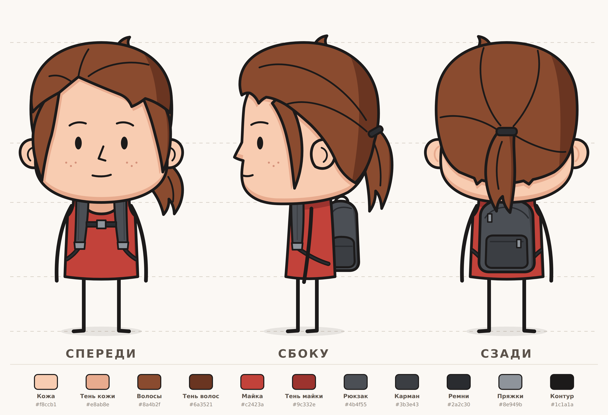
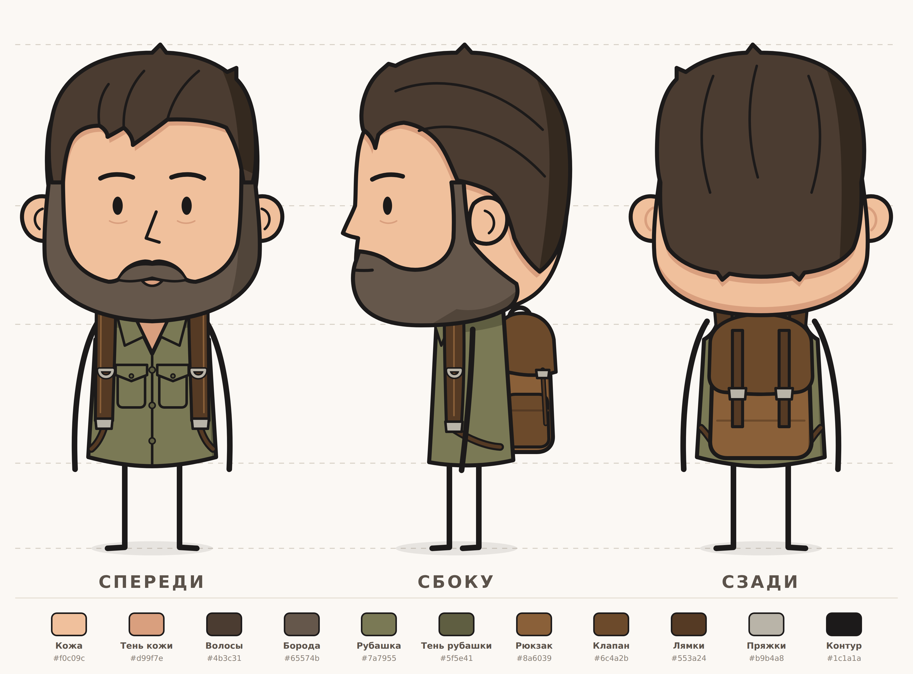
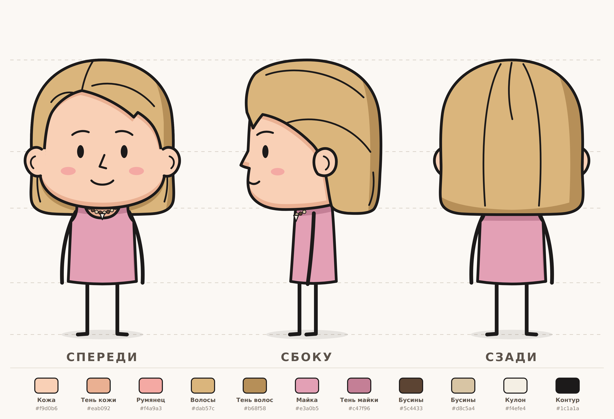

# Персонажи — развороты (спереди / сбоку / сзади)

Все персонажи нарисованы в стиле первого референса: большая голова, простое лицо
(глаза-овалы, нос «уголком»), толстый чёрный контур, плоская заливка с одной тенью.
**Руки и ноги — палки.**

## Элли



- **Одежда:** красная майка без рукавов.
- **Волосы:** каштановые с рыжиной — боковой пробор, чёлка набок, пряди у лица,
  хвост на тёмной резинке.
- **Рюкзак:** чёрно-серый. Спереди лямки с пряжками и нагрудным ремешком, сбоку — рюкзак
  в профиль с боковым карманом, сзади — молния и передний карман.
- Веснушки на щеках.

## Джоэл



- **Одежда:** рубашка цвета хаки без рукавов — воротник, планка с пуговицами, два
  нагрудных кармана с клапанами.
- **Голова:** короткие тёмные волосы, короткая борода с проседью и усы, густые брови.
- **Рюкзак:** коричневый. Спереди лямки с металлическими D-кольцами и пряжками, сбоку —
  клапан и боковой карман, сзади — клапан с двумя ремешками на пряжках.
- **Рост:** Джоэл выше Элли. Его холст 600×1100 вместо 600×1000, земля на том же отступе
  снизу, поэтому в одном масштабе рост соотносится правильно.

## Сара



- **Одежда:** розовая майка без рукавов.
- **Волосы:** светлое каре до подбородка, чёлка набок от пробора, пряди заправлены за уши.
- **Детали:** бусы с кулоном-зубом, как на фото; румянец и улыбка.
- **Рост:** немного ниже Элли — голова и тело примерно 94 % от неё, холст тот же 600×1000.

## Файлы

| Путь | Что это |
|---|---|
| `characters/<имя>/front.svg`, `side.svg`, `back.svg` | отдельные виды, вектор |
| `characters/<имя>/turnaround.svg` | лист-разворот: три вида, направляющие по высоте, палитра |
| `characters/<имя>/png/*.png` | те же файлы в PNG ×2; отдельные виды — на прозрачном фоне |
| `tools/ellie.py`, `tools/joel.py`, `tools/sarah.py` | формы и палитра каждого персонажа |
| `tools/charlib.py` | общие функции: примитивы SVG, лист-разворот |
| `tools/build_characters.py` | сборка SVG |
| `tools/render.js` | рендер SVG → PNG |

## Слои для анимации

Каждая часть лежит в отдельной группе `<g id="вид-часть">`, например `front-arm-left`,
`side-beard`, `back-backpack`. `left`/`right` — сторона самого персонажа: на виде спереди
`front-arm-left` находится справа от зрителя.

| Персонаж и вид | Группы (снизу вверх по порядку отрисовки) |
|---|---|
| Элли, спереди | `ponytail`, `hair-back`, `leg-right`, `leg-left`, `arm-right`, `arm-left`, `neck`, `top`, `backpack-straps`, `ear-right`, `ear-left`, `face`, `face-features`, `hair-lock-left`, `hair-lock-right`, `hair-tuft`, `hair` |
| Элли, сбоку | `ponytail`, `leg-left`, `leg-right`, `backpack`, `top`, `backpack-strap`, `arm-right`, `head`, `face-features`, `ear-right`, `hair-lock-right`, `hair-tuft`, `hair`, `hair-tie` |
| Элли, сзади | `leg-left`, `leg-right`, `arm-left`, `arm-right`, `top`, `backpack`, `ear-left`, `ear-right`, `head`, `hair-tuft`, `hair`, `ponytail`, `hair-tie` |
| Джоэл, спереди | `hair-back`, `leg-right`, `leg-left`, `arm-right`, `arm-left`, `neck`, `shirt`, `backpack-straps`, `ear-right`, `ear-left`, `face`, `face-features`, `beard`, `hair` |
| Джоэл, сбоку | `leg-left`, `leg-right`, `backpack`, `shirt`, `backpack-strap`, `arm-right`, `head`, `ear-right`, `face-features`, `beard`, `hair` |
| Джоэл, сзади | `leg-left`, `leg-right`, `arm-left`, `arm-right`, `shirt`, `backpack`, `ear-left`, `ear-right`, `head`, `hair` |
| Сара, спереди | `hair-back`, `leg-right`, `leg-left`, `arm-right`, `arm-left`, `neck`, `top`, `necklace`, `face`, `face-features`, `hair`, `ear-right`, `ear-left` |
| Сара, сбоку | `leg-left`, `leg-right`, `top`, `necklace`, `arm-right`, `head`, `face-features`, `hair`, `ear-right` |
| Сара, сзади | `leg-left`, `leg-right`, `arm-left`, `arm-right`, `top`, `ear-left`, `ear-right`, `hair` |

Руки и ноги — одиночные линии; первая точка пути — плечо или бедро, её удобно брать за
точку поворота.

## Палитры

| Что | Элли | Джоэл | Сара |
|---|---|---|---|
| Кожа / тень | `#f8ccb1` / `#e8ab8e` | `#f0c09c` / `#d99f7e` | `#f9d0b6` / `#eab092` |
| Волосы / тень | `#8a4b2f` / `#6a3521` | `#4b3c31` / `#34291f` | `#dab57c` / `#b68f58` |
| Борода / тень | — | `#65574b` / `#51453a` | — |
| Одежда / тень | майка `#c2423a` / `#9c332e` | рубашка хаки `#7a7955` / `#5f5e41` | майка `#e3a0b5` / `#c47f96` |
| Рюкзак / карманы, клапан | `#4b4f55` / `#3b3e43` | `#8a6039` / `#6c4a2b` | — |
| Ремни, лямки | `#2a2c30` | `#553a24` | — |
| Пряжки, металл | `#8e949b` | `#b9b4a8` | — |
| Бусы: тёмные / светлые / кулон | — | — | `#5c4433` / `#d8c5a4` / `#f4efe4` |
| Веснушки, румянец | `#d4917a` | — | `#f4a9a3` |
| Контур | `#1c1a1a` | `#1c1a1a` | `#1c1a1a` |

## Как пересобрать

```bash
python3 tools/build_characters.py        # SVG всех персонажей (или: ... sarah)

# PNG: нужен Node.js и Playwright (ставится один раз)
npm i --no-save playwright && npx playwright install chromium
node tools/render.js                     # PNG ×2 (или: node tools/render.js 2 sarah)
```

## Фоны Minecraft: поле с порталом

Поле, впереди трава, сзади роща, посередине поля портал в Незер из обсидиана.
**Внутри портала пусто** — туда вставляется своя анимация. Два квадратных кадра
1080×1080, отрендерены в Blender, разложены на слои для параллакса.

| Папка | Кадр |
|---|---|
| `backgrounds/field/field/` | общий план поля: трава впереди, портал правее центра вдали, роща сзади |
| `backgrounds/field/portal/` | портал по центру кадра, вид спереди с другой точки |

В каждой папке:

- `preview.png` — весь фон, как он выглядит в кадре;
- `parallax.mp4` — проверка: камера чуть едет и наезжает, слои двигаются с разной скоростью;
- `layers/` — слои 1350×1350: кадр плюс запас 135 px с каждой стороны, чтобы камеру
  можно было двигать без пустых краёв.

### Слои (снизу вверх)

| Слой | Что на нём | Глубина: общий план / портал, блоков |
|---|---|---|
| `sky.png` | небо и облака, непрозрачный | бесконечность |
| `far.png` | роща и дальняя часть поля | 45 / 40 |
| `mid.png` | середина поля | 18 / 13 |
| `ground.png` | трава, на которой стоят персонажи | 4,5 / 7,5 |
| `portal.png` | только рамка портала, проём прозрачный | 21 / 12 |
| `fg.png` | размытая трава перед камерой | 2,4 / 2,4 |
| `portal_glow.png` | фиолетовый свет портала на траве и рамке, чёрный фон | как `portal` |
| `portal_mask.png` | проём портала белым — по нему кладётся своя анимация портала | как `portal` |

- Персонажей кладут **между `portal` и `fg`**. Если персонаж стоит дальше портала
  (заходит за него) — между `ground` и `portal`.
- Портал есть только на слое `portal`: выключишь слой — останется чистое поле.
- `portal_glow` — по желанию: режим смешивания слоя **Add** или **Screen**, силу
  регулировать прозрачностью.
- Масштаб персонажей: у ног 1 блок = **160 px** на общем плане и **120 px** на кадре
  с порталом. Персонаж ростом с игрока Minecraft (1,8 блока) — 288 px и 216 px.
- Точки, где у персонажа ноги, и углы проёма портала лежат в `layers/scene.json`.

### Как поставить в Moho

1. Проект 1080×1080. Слои по одному: *File → Import → Image*, порядок как в таблице.
2. Картинка 1350×1350 должна выходить за рамку кадра на 135 px со всех сторон. Если Moho
   вписал её в кадр целиком, поставь слою масштаб 1,25.
3. Неподвижная камера — больше ничего не нужно. Наезд и панораму можно делать
   сразу всей сценой.
4. Камера с объёмом — слои надо разнести по глубине (инструмент *Translate Layer*,
   поле Z), ближние ближе к камере, дальние дальше. Глубины в таблице. Или пришли
   анимацию персонажей PNG-последовательностью с прозрачным фоном: параллакс соберёт
   `tools/mc_parallax.py`, как в `parallax.mp4`.

### Как пересобрать

```bash
# нужен Blender 4.2+ (без аддонов), рендер на процессоре ~10 мин на кадр
blender -b --factory-startup -P tools/mc_field.py -- --shot field
blender -b --factory-startup -P tools/mc_field.py -- --shot portal
# черновик за полминуты: ... --scale 0.35 --samples 16 --layers beauty

python3 tools/mc_post.py backgrounds/field/*/layers     # свечение, маска, preview.png
python3 tools/mc_parallax.py backgrounds/field/portal   # parallax.mp4 (нужен ffmpeg)
```

Сцена, камеры, свет и цвета — константы в начале `tools/mc_field.py`.

### Текстуры

`backgrounds/textures/pixel-perfection/` — текстуры Pixel Perfection (XSSheep,
[CC BY-SA 4.0](https://creativecommons.org/licenses/by-sa/4.0/)), взяты из игры
[Mineclonia](https://codeberg.org/mineclonia/mineclonia). Файлы названы как в Minecraft, поэтому
можно подставить текстуры из своей игры: распакуй `assets/minecraft/textures/block`
из `.minecraft/versions/<версия>/<версия>.jar` в отдельную папку и запусти
`tools/mc_field.py` с `--tex <папка>`. Текстуры Mojang в репозиторий не кладём.
