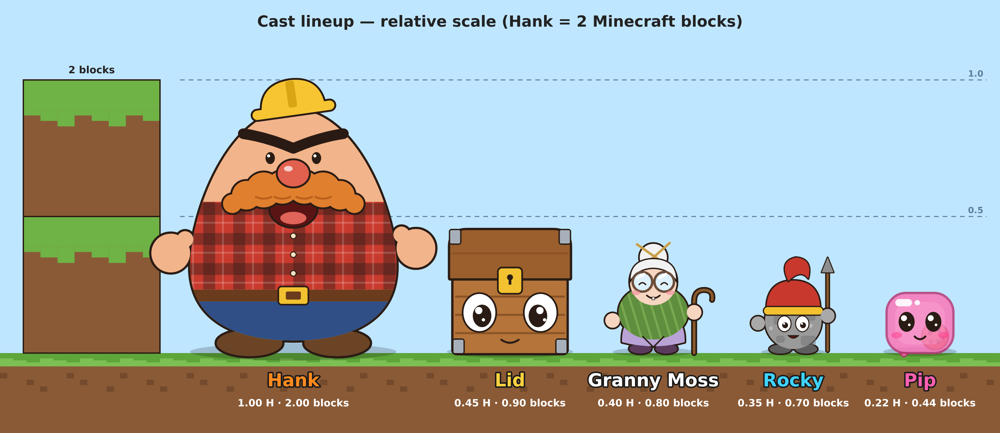
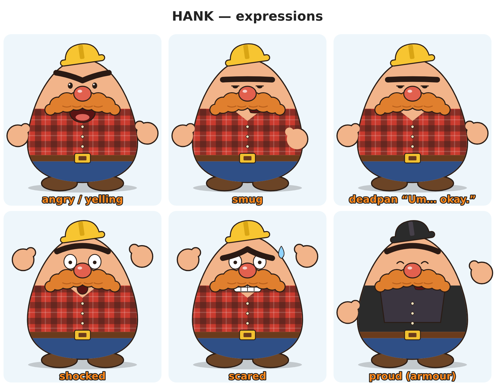
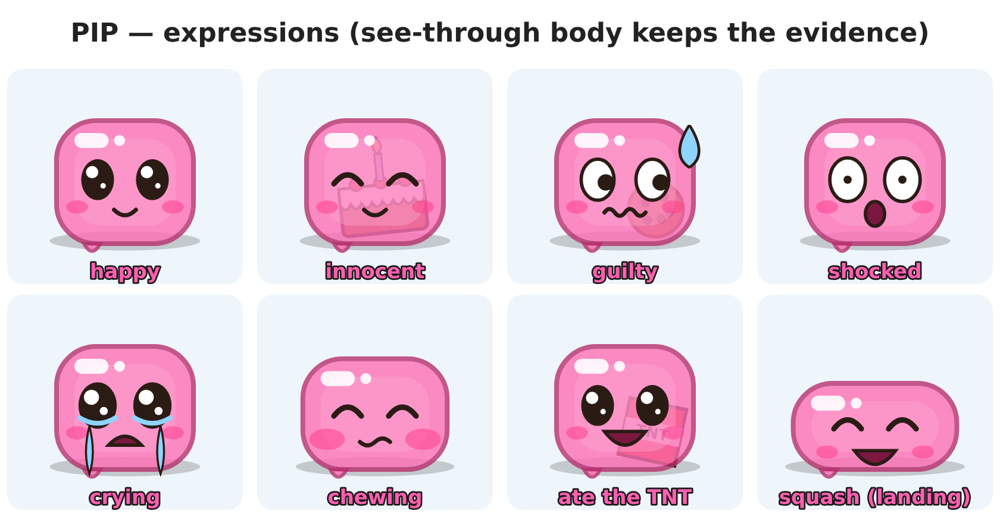
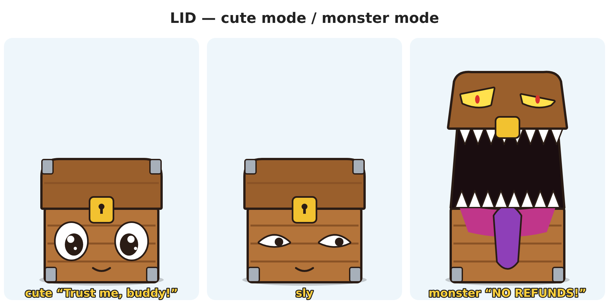
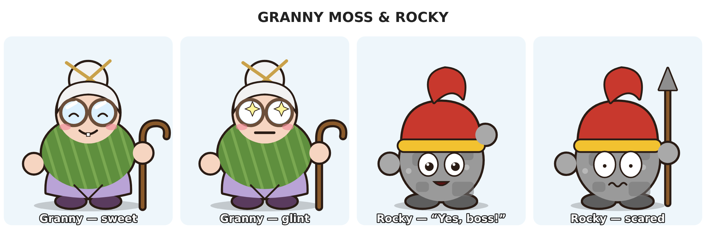

# Персонажи

Новые персонажи для шортсов с двумя POV в мире Minecraft. Стиль — плоское 2D, как у toonz CRAFT:
- простые фигуры и плоская заливка, тёмный контур;
- **рук нет, кисти — отдельные «плавающие» круги**;
- лицо меняется целиком, как отдельные картинки;
- под каждым персонажем мягкая тень.

Персонажи свои, не пародии. На канале работают пары, контрастные по росту и характеру, поэтому каст
собран из таких пар.

| Персонаж | Роль | Рост (от Хэнка) | В блоках Minecraft | Глаза камеры (POV) | Цвет субтитров |
|---|---|---|---|---|---|
| **Hank** | большой ворчун, «главный» | 1,00 | 2,0 | 1,7 блока | оранжевый `#FF8A1F` |
| **Lid** | хитрый сундук-мимик | 0,45 | 0,9 | 0,6 блока | золотой `#FFD23F` |
| **Granny Moss** | милая бабушка, тайно всемогущая | 0,40 | 0,8 | 0,65 блока | белый `#FFFFFF` |
| **Rocky** | наивный каменный стражник | 0,35 | 0,7 | 0,55 блока | голубой `#3FD3FF` |
| **Pip** | крошечный желе-кубик, ест всё | 0,22 | 0,45 | 0,3 блока | розовый `#FF5FB0` |

Высота «глаз» нужна для фона: на этой высоте ставится камера Minecraft, когда половина экрана
показывает взгляд этого персонажа. Как это сделать — в
[guide/world-and-screenshots.md](../guide/world-and-screenshots.md).

**Пары:**
- **Hank + Pip** — главная пара: большой ворчун и крошечный навязчивый хаос.
- **Lid + Rocky** — хитрец и простак: Lid обманывает, Rocky верит всему.
- **Granny Moss** — джокер: с ней любая сцена заканчивается неожиданно.

**Где живут.** Дом Хэнка стоит на холме. Pip живёт у него без спроса. По соседству — домик Granny Moss
с огородом и печеньем, огород сторожит Rocky. Lid бродит по округе, притворяется торговцем и охотится
за изумрудами Хэнка.

---

## Hank

**Характер.**
- Громкий, гордый, ленивый и жадный до алмазов.
- Считает себя гениальным строителем, хотя всё, что строит, разваливается.
- Ведётся на лесть и «бесплатное».
- В глубине души любит Pip, но никогда не признается.

**Форма.**
- Большое яйцо: узкий верх, широкий низ. Голова и тело — одно целое, шеи нет. Ширина ~80 % высоты.
- **Голова:**
  - лысая;
  - сверху **маленькая жёлтая строительная каска**, на размер меньше, чем надо, чуть набок;
  - одна густая чёрная **монобровь** — главный инструмент эмоций;
  - глаза-точки;
  - большой **красный нос-картошка**;
  - **огромные рыжие усы-«облако»**, рот под ними, виден только когда открыт.
- **Тело:**
  - красно-чёрная клетчатая рубашка с вырезом и тремя пуговицами;
  - коричневый ремень с большой золотой пряжкой;
  - синие джинсы.
- **Кисти** — круги-варежки с большим пальцем. **Ноги** — коричневые овальные ботинки.

**Цвета:**
- кожа `#F2B48A`, рубашка `#C93A2E` в клетку `#3A1F1A`;
- джинсы `#2F4F86`, ботинки `#6B4426`;
- усы `#E07F2E` (тень `#B85F1C`), нос `#E2604E`, каска `#F7C531`;
- контур `#2A1C15`.

**Выражения** (картинки для замены):
- злой/кричит;
- самодовольный;
- без эмоций («Um… okay.»);
- шок;
- страх (пот);
- гордость;
- спит;
- плачет — редко, для «грустных историй».

**Рот (для синхронизации губ):**
- закрыт (только усы);
- «О»;
- открыт широко (крик);
- зубы сжаты.

Когда Хэнк говорит, рот меняется каждые 2–3 кадра, а усы подпрыгивают вместе с ним.

**Голос.**
- Взрослый мужской, хрипловатый, громкий.
- Обычный тон ~120–150 Гц. **Почти всё время кричит**, на крике ~200–260 Гц.
- Без эмоций резко падает до ~100 Гц («Um… okay.») — это главный комический приём.
- Темп 4–5 слов/с на крике, 2 слова/с без эмоций.

**Фразы:** «Do you know who I AM?», «I KNEW that.», «PIP!!!»

---

## Pip

**Характер.**
- Восторженный, любопытный, обожает Хэнка (зовёт его «Hanky»).
- **Ест всё подряд.** Врёт с самым невинным лицом.

**Главная фишка: тело прозрачное, всё съеденное видно внутри.** Торт со свечкой, TNT, печенье,
изумруд. Улика всегда на виду, и вокруг этого строится половина шуток: Pip говорит «What cake?», а
торт у него внутри.

**Форма.**
- Мягкий розовый **кубик-желе** со скруглёнными углами, полупрозрачный (~80 %).
- Светлая сердцевина, белый блик слева сверху, по краю тёмно-розовый контур.
- Снизу маленькая капелька.
- Конечностей нет: двигается **прыжками**, сплющивается при приземлении и вытягивается в прыжке.

**Лицо:** большие блестящие чёрные глаза-овалы с двумя бликами, маленький рот, румяные щёки.

**Цвета:** тело `#FF6FB5` (80 % непрозрачности), сердцевина `#FFB0D6`, контур `#B8306F`, щёки
`#FF3F8E`.

**Выражения:**
- счастливый;
- невинный (глаза-дуги);
- виноватый (глаза в сторону, волнистый рот, капля пота);
- шок (крошечные зрачки);
- плачет;
- жуёт (щёки раздуты);
- улыбка до ушей;
- сплющен при приземлении.

**Съеденное внутри** — отдельный слой под телом. Тогда розовый цвет «тонирует» предмет, и он выглядит
как в желе.

**Голос.**
- Высокий писклявый мультяшный, ~350–450 Гц.
- Яркий, быстрый, с хихиканьем.
- Фирменный звук «bloop!» при приземлении, смешок «hehe».

**Фразы:** «It wasn't me!», «Hanky!», «Bloop!»

---

## Lid

**Характер.**
- Сундук-мимик и мошенник-продавец. Ко всем обращается «buddy».
- Предлагает «бесплатные алмазы внутри», продаёт подделки.
- Если его раскусили, **превращается в монстра**: крышка распахивается, как пасть. Потом снова
  становится милым.
- Это наш вариант приёма Фалсити «милый ↔ страшный».

**Форма.**
- Обычный деревянный сундук: корпус в досках, тёмная крышка, железные уголки.
- Золотой замок посередине — на месте «носа».
- **Глаза на передней стенке:** огромные щенячьи (милый режим) или прищуренные (хитрый).
- Под ними маленькая улыбка.
- Двигается прыжками на месте.

**Режим монстра:**
- крышка поднята высоко и стала «верхней челюстью» с жёлто-красными злыми глазами;
- внутри тёмная пасть с рядами белых треугольных зубов;
- длинный фиолетовый язык.

**Цвета:**
- корпус `#B4743A`, доски `#8A5326`, крышка `#9A5F2C`;
- железо `#A7B0BA`, замок `#F2C230`;
- пасть `#1A0D10`, язык `#8E3FB8`.

**Голос.**
- Гладкий быстрый «продавец», мужской, ~180–250 Гц, немного в нос.
- В режиме монстра голос понижен и с перегрузом, рык.

**Фразы:** «Trust me, buddy!», «Free diamonds inside!», «No refunds!»

---

## Granny Moss

**Характер.**
- Милая медленная бабушка: чай, печенье, «Oh, dearie…».
- **Тайно всемогущая и беспощадная.** Одно движение трости — и обидчик летит за горизонт.
- Шутка всегда в контрасте между тоном и действием.

**Форма.**
- Маленькое круглое тело в мшисто-зелёной вязаной шали, снизу сиреневое платье.
- Белый пучок волос со спицами.
- **Огромные круглые очки.** Когда она серьёзна, линзы становятся белыми со звёздочкой-бликом,
  и глаз не видно.
- Улыбка с одним зубом, трость с крючком.

**Цвета:**
- шаль `#5F8F3E` (полоски `#86B35A`), платье `#B9A3D6`;
- кожа `#F6D5C1`, волосы `#F2F2F2`;
- оправа `#6B4E3A`, трость `#8A5A2B`.

**Выражения:** милая (глаза-дуги), «блик» (серьёзно), ровный рот, хохот.

**Голос.**
- Медленная мягкая хрипловатая старушка, ~200–240 Гц, с дрожью. Темп 2–2,5 слова/с.
- Иногда внезапно глубокий строгий голос — это и есть шутка.

**Фразы:** «Oh, dearie…», «Kids these days.»

---

## Rocky

**Характер.**
- Наивный исполнительный стражник огорода Granny Moss.
- Понимает всё буквально и слушается любого, кто звучит официально. Отдаёт честь.

**Форма.**
- Круглый камень-булыжник с тёмными и светлыми пятнами.
- Великоватый красный шлем с золотым ободом и плюмажем.
- Большие круглые глаза, маленький рот, каменные кисти-круги.
- Деревянное копьё с каменным наконечником.

**Цвета:** камень `#9A9A9A` (пятна `#777777`), шлем `#C8382D`, обод `#F2C230`, копьё `#8A5A2B`.

**Выражения:** готов служить («Yes, boss!», отдаёт честь), испуг, думает (глаза вверх), гордость.

**Голос.** Высокий бодрый мальчишеский, ~300–380 Гц, вежливый, отвечает очень быстро.

**Фразы:** «Yes, boss!», «Password?»

---

## Как рисовать (общие правила)

1. **Контур** тёмно-коричневый `#2A1C15`, толщина ~1 % высоты персонажа (у Хэнка 8–10 px при росте
   900 px). Одна сплошная линия вокруг всего силуэта: внутренние детали тоньше.
2. **Заливка плоская**, максимум одна тень или блик. Никаких градиентов на теле, кроме желе Pip.
3. **Каждая часть — отдельный слой:**
   - тело;
   - каждая кисть;
   - ноги;
   - бровь;
   - глаза;
   - рот;
   - усы;
   - аксессуар.

   Анимация — это сдвиг, поворот и масштаб слоёв плюс замена картинки лица.
4. **Тень на земле** — мягкий тёмный эллипс под ногами, ~18 % непрозрачности.
5. **Рисовать с запасом:** Хэнк ~1000 px высотой, Pip ~400 px. В крупном плане персонаж
   занимает половину экрана, и картинка не должна мылиться.
6. **Масштаб на фоне** считают в блоках Minecraft (таблица выше). Pip рядом с сундуком — чуть
   выше его половины. Хэнк — ровно два блока.

## Файлы

| Путь | Что это |
|---|---|
| `concepts/lineup.png` | состав в одном масштабе рядом с двумя блоками Minecraft |
| `concepts/hank.png`, `pip.png`, `lid.png`, `granny-rocky.png` | листы выражений |
| `concepts/*.svg` | те же листы в векторе: можно открыть в Figma, Illustrator или Inkscape и разобрать на части |
| `tools/concepts.py` | генератор листов (`python3 cast/tools/concepts.py`) |
| `tools/render.js` | SVG → PNG (`NODE_PATH=$(npm root -g) node cast/tools/render.js`) |
