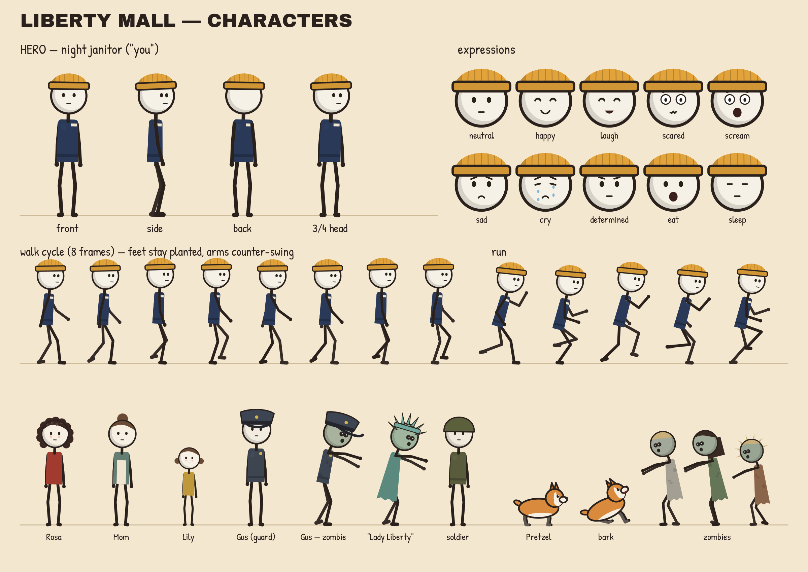

# Персонажи

Стиль тот же, что у конкурента, но персонажи свои: большая круглая голова (диаметр
головы — единица роста, фигура около 4 голов), глаза-точки, тёмные палочные руки и ноги
со сгибом в коленях и локтях, узкое цветное тело, толстый контур, тень на затылке.

## Герой — ночной уборщик Сэм («ты»)
- Горчичная шапка-бини с отворотом и тёмно-синяя рабочая рубашка с бейджем.
- Узнаётся по силуэту шапки и двум цветам: жёлтый верх и синий низ.
- Эмоции: спокойствие, улыбка, смех, страх, крик, грусть, плач со слезами, решимость,
  еда, сон. Брови появляются только на сильных эмоциях.
- Движения: ходьба, быстрый шаг, бег с фазой полёта, на цыпочках, толкание тяжестей.
  Стопы ставятся по IK и не скользят по полу.

## Претцель — щенок корги
- Рыже-белый, большие уши, хвост-обрубок виляет.
- Позы: стоит, сидит, лежит, рысь, бег, прыжок, лай.

## Роза
- Живёт напротив, на 20-м этаже. Кудрявые тёмные волосы, красный свитер, румянец.
- Общается табличками на картоне. Выживает и в финале прилетает на вертолёте.

## Гас — ночной охранник
- Фуражка, серая форма, жетон. В день 1 машет на прощание, в день 16 выходит из лифта
  уже зомби. Остаток фильма сидит за решёткой мебельного «Sleep Kingdom».

## Мама и Лили
- Мама: пучок, зелёная кофта, фартук. Лили (9 лет): хвостики, жёлтое платье.
- Появляются в воспоминании (день 11), на фото (день 19) и в эпилоге.

## Зомби
- Серо-зелёные головы, тёмные глазницы с маленькими зрачками, приоткрытый рот.
- Одежда из жизни Нью-Йорка: офисный костюм с галстуком, строитель в жилете и каске,
  турист в футболке «I ♥ NY», бегун с повязкой, пальто, платья, рваные края и пятна.
- «Статуя Свободы» — уличный аниматор в зелёном костюме с короной. Первой подходит
  к дверям в день 1, врезается в окно в день 11, последней тянет руки к вертолёту.
- Походка: одна нога волочится, руки вперёд, голова набок.

## Прочие
Солдат в каске (день 30) и манекены без лиц в лучшей одежде ТЦ (дни 27–29).
